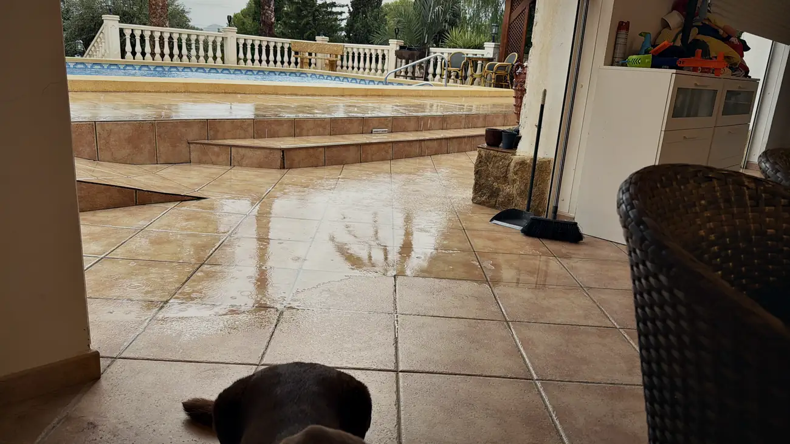
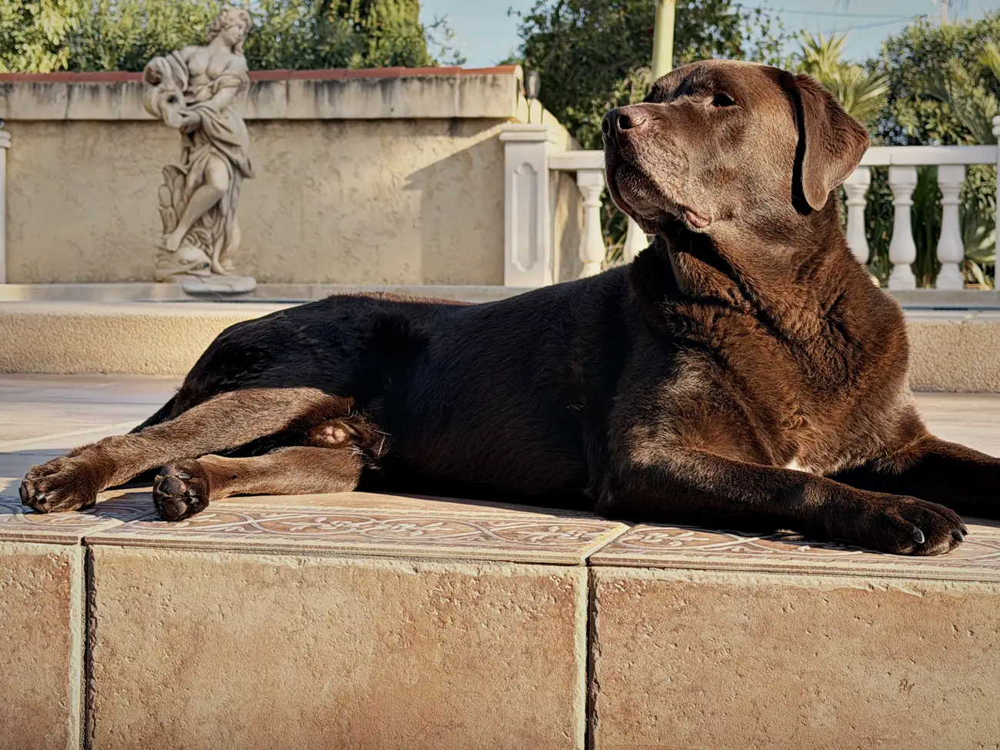
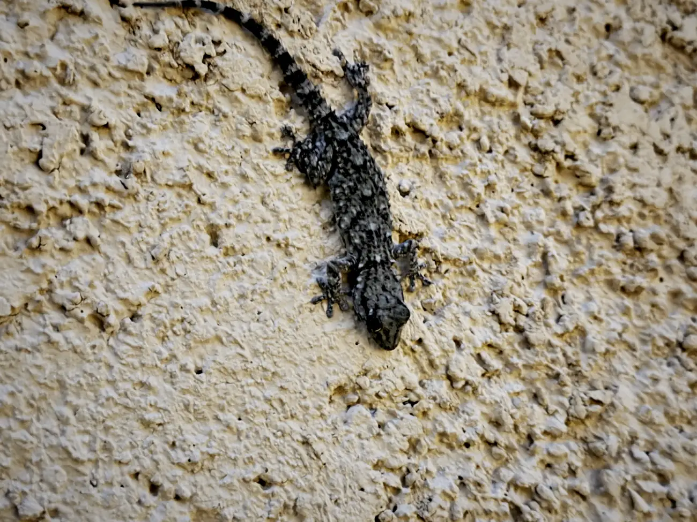
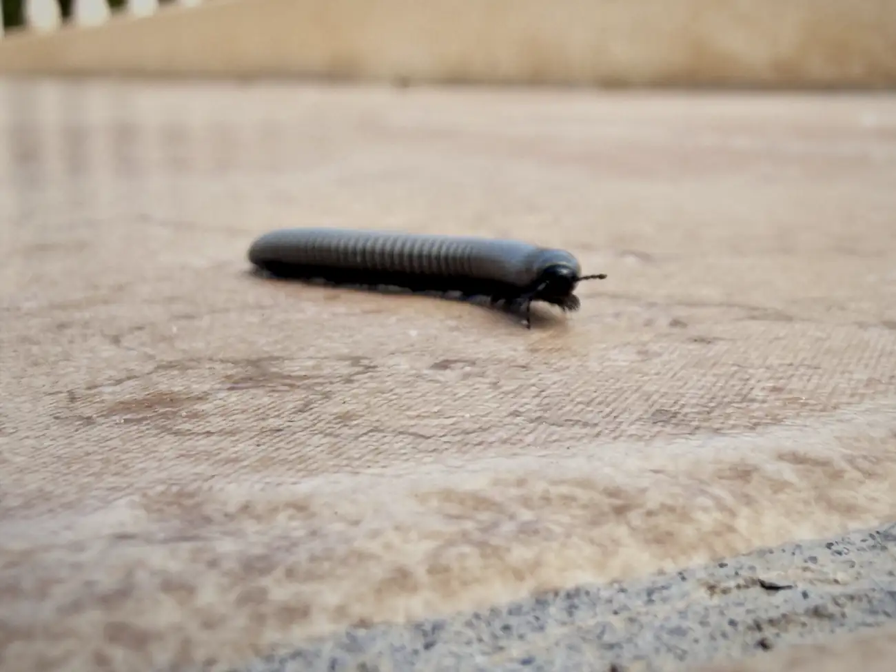
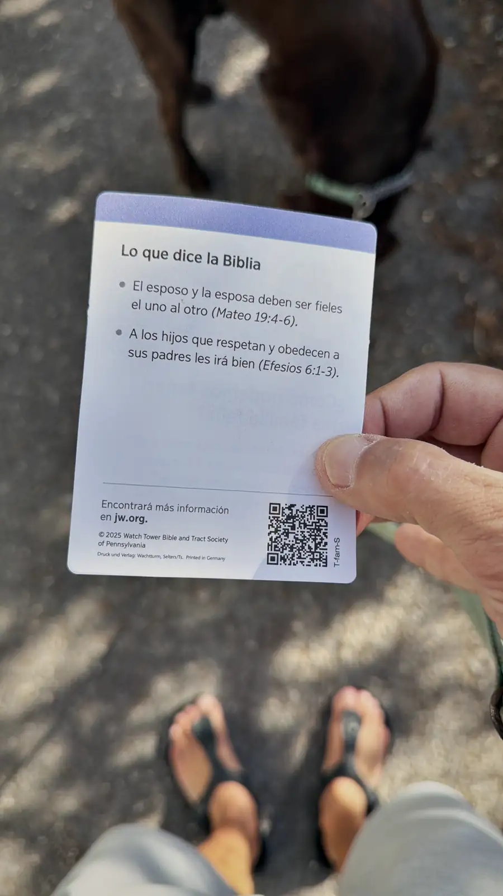
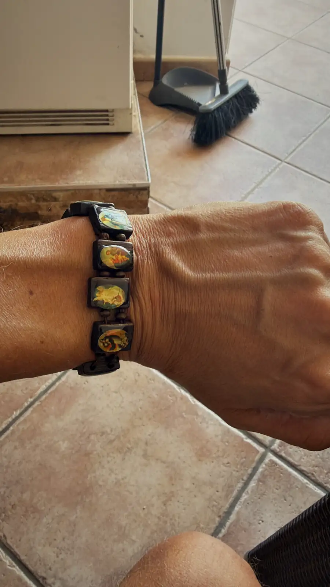
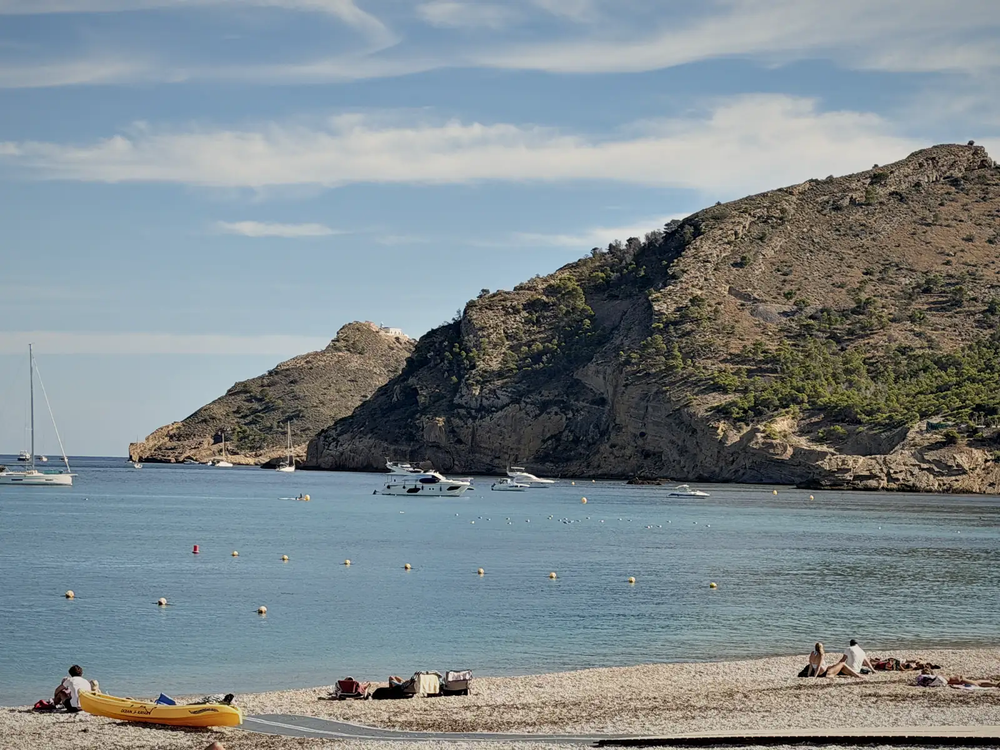

Het is zondag 11 oktober en het is alweer even geleden dat ik hier iets heb neergezet. Wat dat betreft integreer ik al aardig met de Spaanse mentaliteit. Mañana, mañana.

En gek genoeg voelt dat voor mij vreemd, terwijl ik niet voor niets voor dit leven heb gekozen.

## ¿Echas de menos Holanda?

Die vraag kreeg ik vandaag. Mis je Nederland?

Ik hoefde er geen seconde over na te denken en zei meteen nee. Ik moet ergens anders zijn dan in Nederland. Als iemand zo'n vraag stelt, is het antwoord snel en vrij duidelijk.

Maar het klinkt stoer, tof, dat je je dromen najaagt. En ik kan alles romantiseren. Je zou kunnen denken dat vertrekken makkelijk is. Of is het vluchten?

Ik kan je vertellen dat je jezelf mee verhuist. Overtuigingen en patronen zijn hier precies hetzelfde. Je verleden en je geschiedenis raak je niet kwijt.

## Stilstaan

Niet dat alles hier rozengeur en maneschijn is.

Afgelopen week hebben we hier heftige regenval gehad. Me bus staat nog steeds stil. En ik ben veel alleen geweest, en dan kom je jezelf tegen. Doe ik het goed? Is dit de juiste keuze?

Ik probeer hier gewoon te werken, maar er komt niets uit me handen. Ik ben moe. Ik ben ook ziekjes geweest. En ik ben vaak op stap geweest. Dat is een patroon waar ik in Nederland geen last van had, maar dat hier makkelijk is.

Vrijdag was het hier feestdag, de Dia de la Comunitat Valenciana. Ik, met me gewoontes, heb daar weer goed gebruik van gemaakt. Met spijt de dag erna.

Ik kan dat niet meer aan.

Begrijp me niet verkeerd, ik vind het fijn om de deur uit te gaan. Ik leer nieuwe mensen kennen en de taal gaat hier razendsnel. Dat is top.

Maar het voelde of ik stilstond. Of ik bevroren was. En dat is gek, want het is hier behoorlijk warm.

Al klopt het wel. Me bus staat stil. Al heb ik er gisteren mee gereden, ik dacht: even die motor tot leven brengen. En toen was het weer vechten in de bergen.

## Zoeken

Ik zit goed hier, maar het is niet waar ik wil zijn.

Aanstaande dinsdag heb ik als het goed is een bezichtiging, en dat is spannend. Ik had het een week geleden al geprobeerd, maar alles is hier mañana, mañana.

Elke ochtend en elke avond loop ik met Mo en kijk ik naar de bergen en naar de zee. Dit is het land waar ik moet zijn.

Maar is het de plek?

Ik denk dat de plek niet uitmaakt. Je moet je ergens goed voelen. En dat heb ik de laatste dagen niet echt gehad.

## Beestjes

En verder kom ik hier gekke beesten tegen. Gekko's op de muur, en van die rare dingen op het pad die ik eerst voor slakken aanzag. Blijken gewoon honderd pootjes aan te zitten.

## Welke boodschap mis ik?

Vandaag was ik gelukkig weer het mannetje.

Vanmorgen liep ik met Mo en kreeg ik op straat een flyer van een oude man. Ik verstond er geen moer van, maar het bleken Jehova's getuigen.

Daarna naar de Carrefour, en heerlijk gegeten in Albir bij de Chinees. Als cadeau kreeg ik daar een armbandje met allemaal afbeeldingen van Jezus, of weet ik het. Bij de Chinees.

Ik ben spiritueel, niet christelijk of katholiek. Maar het is wel bijzonder dat ik vandaag meerdere signalen kreeg.

Welke boodschap mis ik?

## Albir

Eind van de middag lekker wezen vertoeven in Albir.

Als ik daar dan op een bankje zit, in een korte broek en een t-shirt, ben ik dankbaar dat ik hier ben. Dankbaar voor deze dag.

Maar ik ben zoekende.

Ik kan doen alsof het leven perfect is in Spanje, en houd me ten goede, ik heb het niet slecht. Maar waar je ook naartoe gaat, je neemt jezelf mee.
