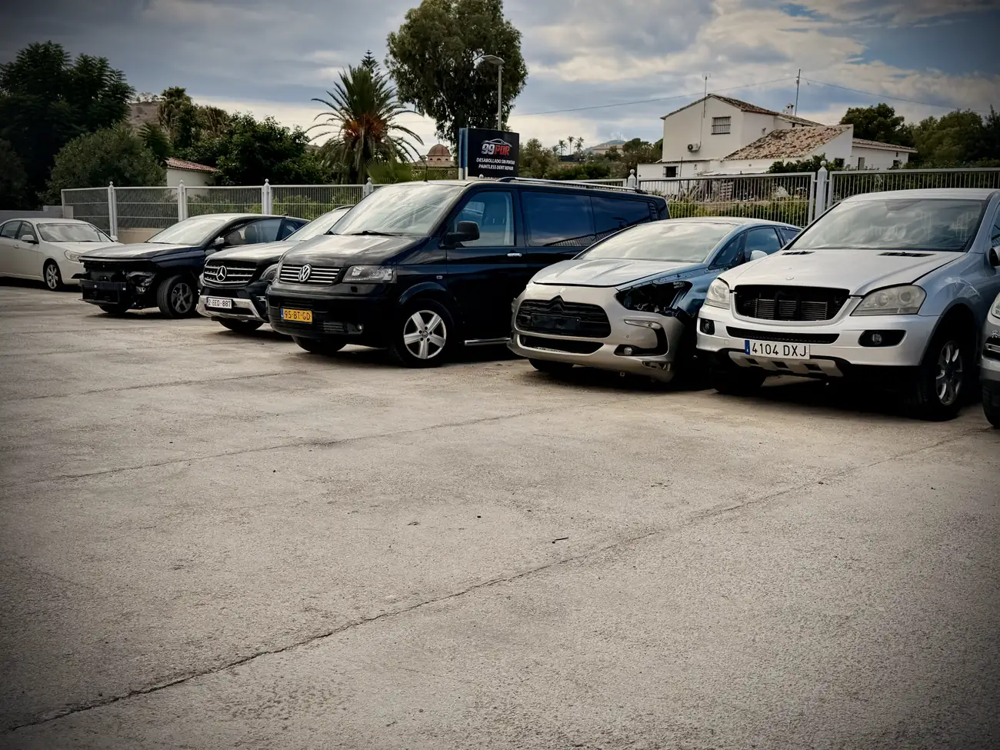
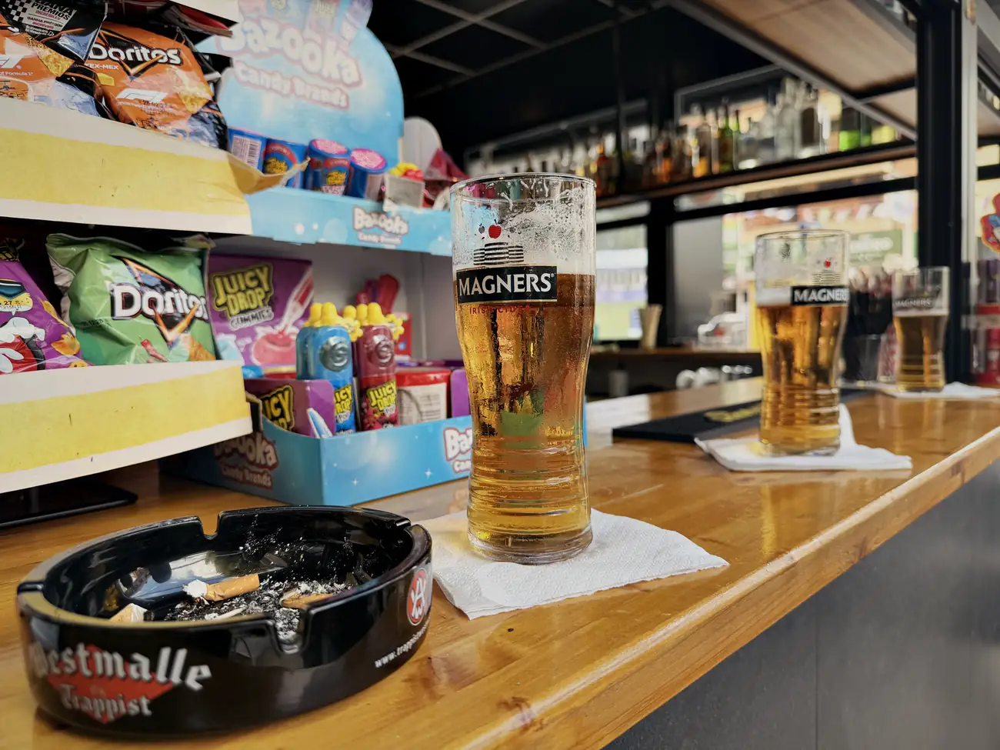
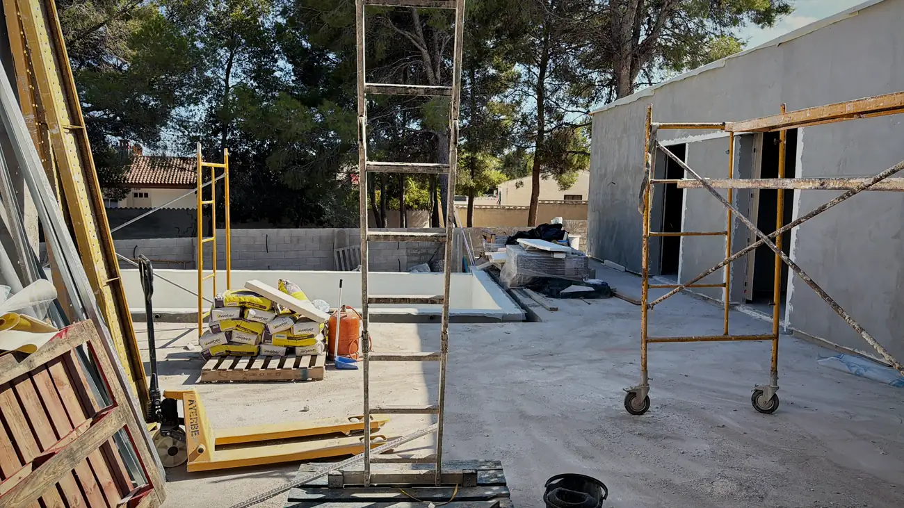
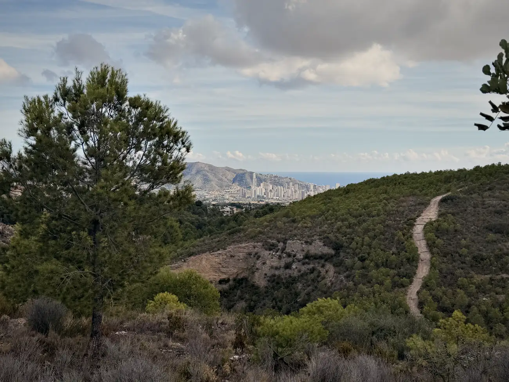
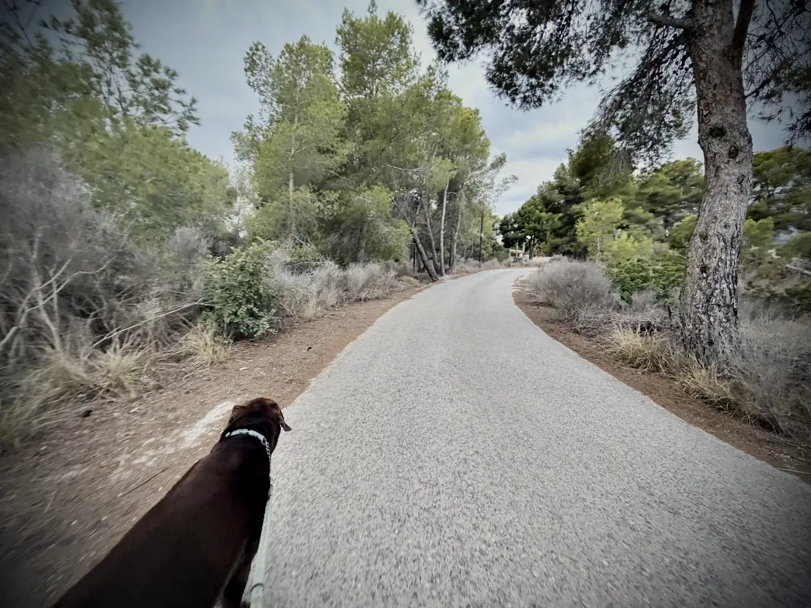
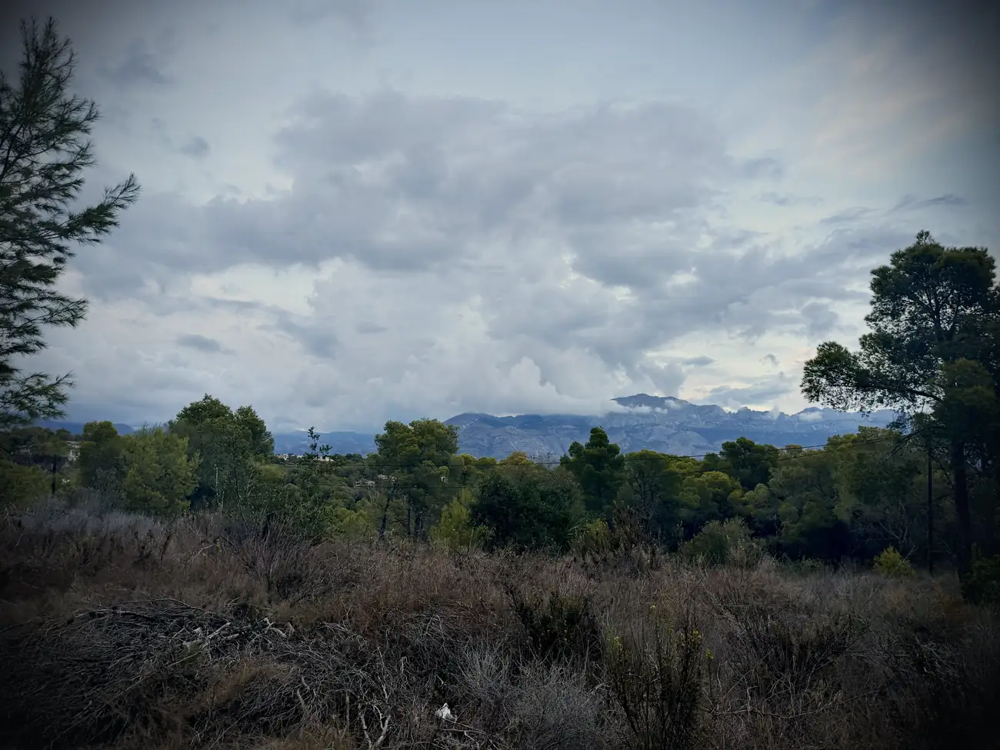
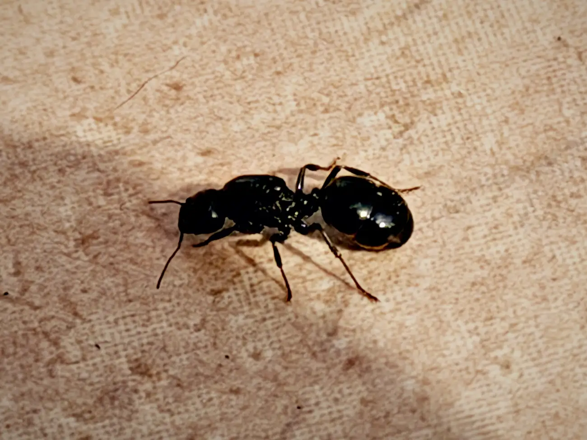

Het is alweer zondag, en een bijzondere.

Vannacht rond 02:50 kreeg ik een telefoontje van me broertje. Half suf nam ik op en eigenlijk wist ik al waarom hij belde. Ik ben opnieuw oom geworden.

Welkom, mooie Levi.

Op dit soort momenten merk je dat die afstand soms een ding is. Normaal had ik vandaag in Brabant gezeten, maar dat werkt nu even anders. Het liefst stap ik in de auto of pak ik een vliegtuig, maar dat zijn een hoop kosten en het geld groeit me niet op de rug.

Gelukkig krijgt Levi er nu nog weinig van mee. Ik kom snel die kant op, knappe vent.

## Mañana, mañana

De auto pakken wordt sowieso lastig, want die staat eindelijk bij een garage in Altea. Ik ben benieuwd hoelang dit geintje gaat duren. Alles is hier mañana, mañana.

En gek genoeg begin ik eraan te wennen. Sterker nog, het past wel bij me. Dat eeuwige racen was ik zat in Nederland, maar tegelijkertijd moet me systeem er blijkbaar van afkicken. Als ik een dag niets doe, of in stilte zit met me gedachten, word ik een soort van ongemakkelijk. Alle stress en ellende van de afgelopen maanden en jaren komt er letterlijk uit.

Het gaat dan ook niet altijd goed. Ik heb echt dagen gehad dat ik me afvraag of ik wel de juiste keuze maak. Of ik hier wel wil zijn. Het duurt me allemaal te lang, terwijl ik eigenlijk alle tijd van de wereld heb en in een luxe positie zit waar ik niet over moet klagen maar die ik moet dragen.

De laatste week gaat dat me wat beter af. Ik heb weer een soort ritme te pakken en ben soms hele dagen aan het werk. Maar ik heb ook dagen dat er niets uit me handen komt. Er zijn dagen dat ik in Benidorm beland en dan is het een biertje, of 2, of 3. En dan loopt je hele dag anders dan gepland.

Daar moet ik aan wennen. Maar eerlijk, het is eigenlijk heerlijk toch? Alleen me systeem denkt daar nog anders over.

Verder ben ik regelmatig te vinden op de bouw bij het nieuwe huis van Pat. Dat begint nu op te schieten en het is leuk om dat van dichtbij mee te maken. Als je er regelmatig komt zie je vooruitgang, maar snel gaat het naar mijn idee niet. Alles is hier rustaghhh aan.

## Die interne JA

Ik begin ook weer bekend te raken met het rijden hier, en ik ontdek nieuwe plekken. Zo was ik van de week bij de internationale school in La Nucia en ben ik een stuk gaan wandelen. Je komt daar opeens op prachtige plekken, en dan voel ik die interne JA.

Het zijn die momenten alleen, of met Mo, dat ik serieus even dat geluksgevoel heb. Begrijp me niet verkeerd, in een bar in Benidorm heb ik het ook naar me zin, lang leve de lol. Maar het is niet waar ik voor gekomen ben.

Ook hier in Alfaz, waar ik tijdelijk verblijf, vind ik steeds mooiere routes om met Mo te lopen. Ik ga gewoon lopen en zie wel waar ik uitkom.

Zo heb ik een prachtige route gevonden van ongeveer een uur, die ik na het eten loop. Net voordat het donker wordt. Je hebt daar schitterend uitzicht op Calpe en je loopt letterlijk de natuur in.

De eerste keer dat ik die liep raakte ik wel lichtelijk in paniek, want ik dacht dat ik niet meer terug zou komen. Geen bereik op me telefoon, dus geen navigatie, niets. Maar ik dacht: links aanhouden, links aanhouden. En voilà, ik stond weer op bekend terrein.

## No pasa nada

Waar je tijdens zo'n wandeling wel gek van wordt, zijn de blaffende honden. Grote en kleine, meestal 2 of 3 per huis. Het lijken hier wel zwerfhonden en ze zien er niet uit. Mo steekt daar knap bij af.

Ze blaffen alsof ze je willen verscheuren, of nou ja, alsof ze Mo willen verscheuren. Ze rennen alle kanten op en blaffen alle andere honden in het dorp wakker.

Mo vindt het maar niets en trekt me arm zowat uit de kom.

Ik probeer nu met die honden te praten en roep steeds: no pasa nada. En gek genoeg werkt dat soms nog ook.

## Regen en reuzen

Inmiddels komt het hier weer met bakken uit de hemel. Vannacht is het ook flink losgegaan. De dag erna zie je dan bijzondere slakken en insecten.

Vandaag word ik geteisterd door reuzenmieren die serieus bijna 2 cm lang zijn. Daar krijg ik af en toe wel de kriebels van. Die wil je niet in je bed.

## Komende week

Benieuwd naar komende week. Als het goed is heb ik nu wel een bezichtiging, want die van afgelopen week ging natuurlijk niet door. En vrijdag ga ik een NIE-nummer regelen, het nummer dat je hier als buitenlander nodig hebt voor zo'n beetje alles. Ook dat liep vertraging op.

Maar het went. We gaan het zien.

Nou lieve jij, bedankt weer voor het lezen. Laat gerust iets achter als je gedachten hebt of iets wilt delen. Ik vind alle reacties zo leuk om te lezen.

Dank jullie wel, en tot snel.
