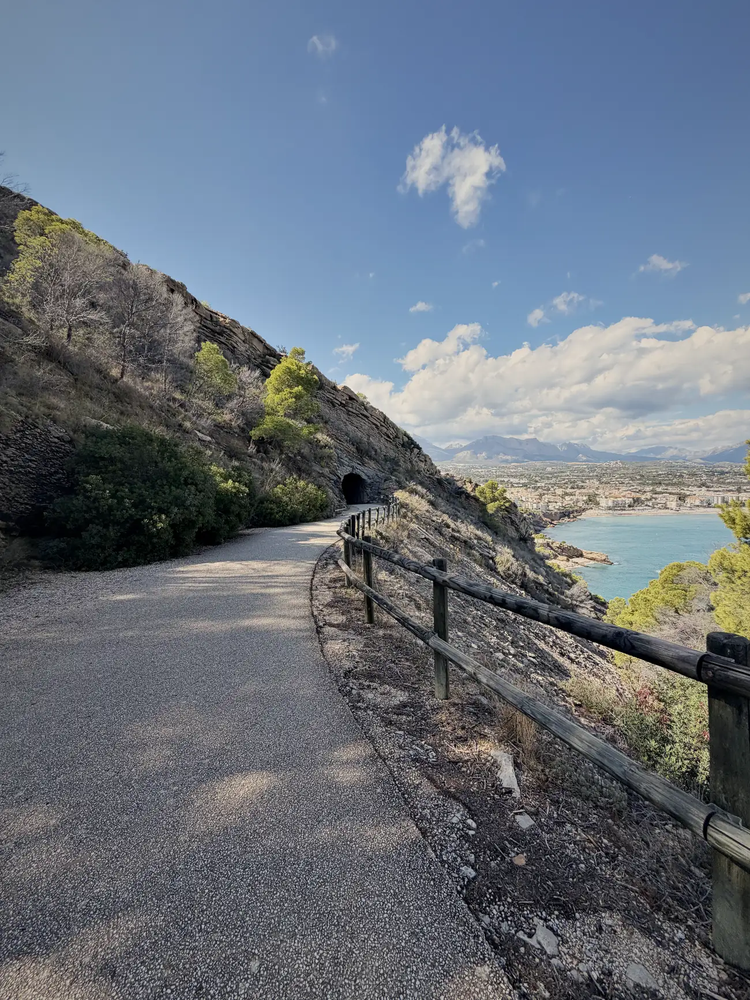
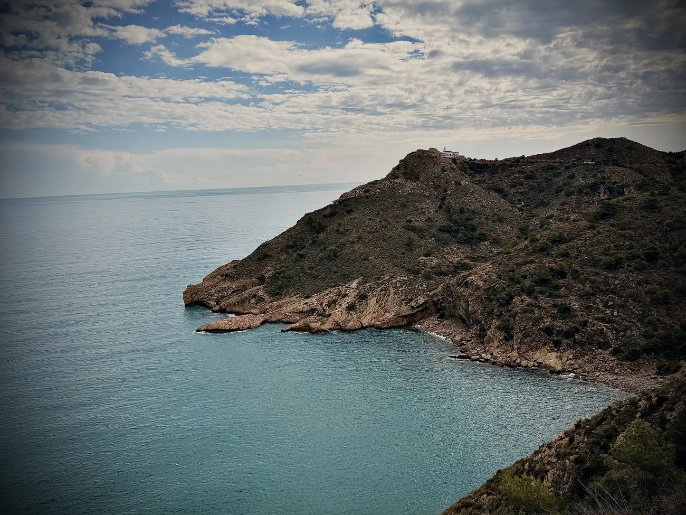
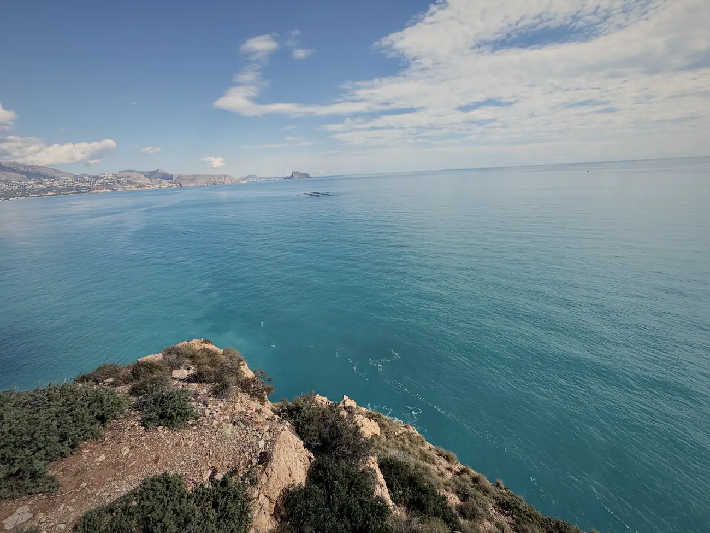
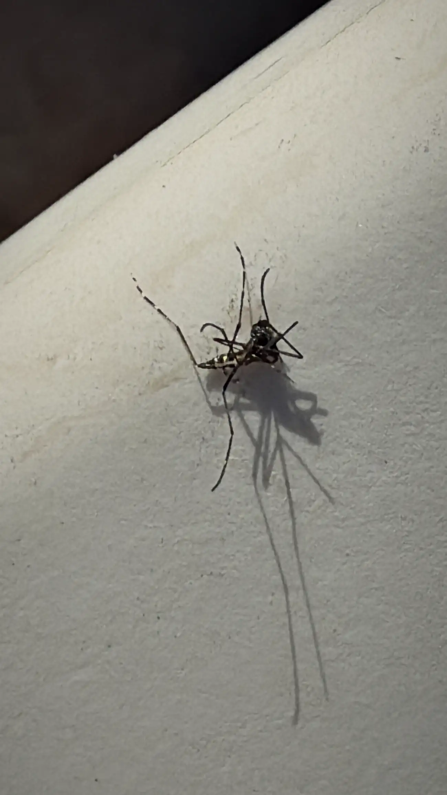
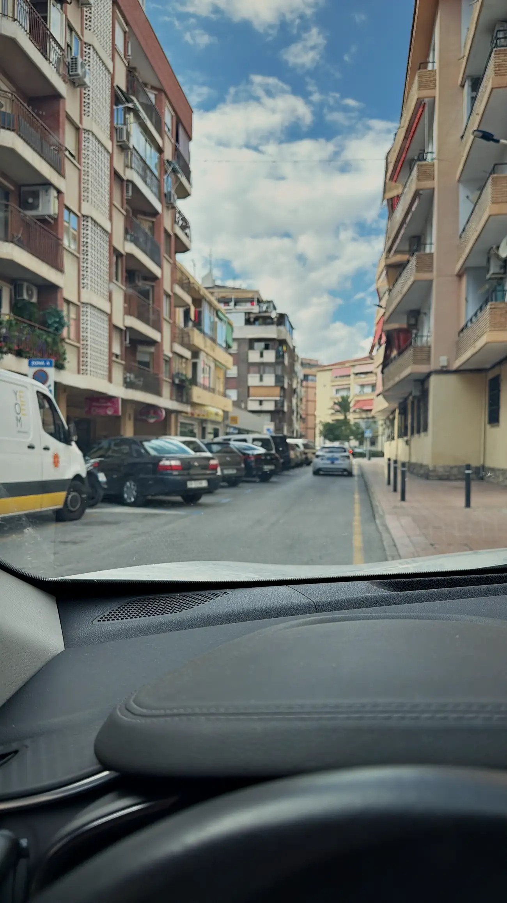
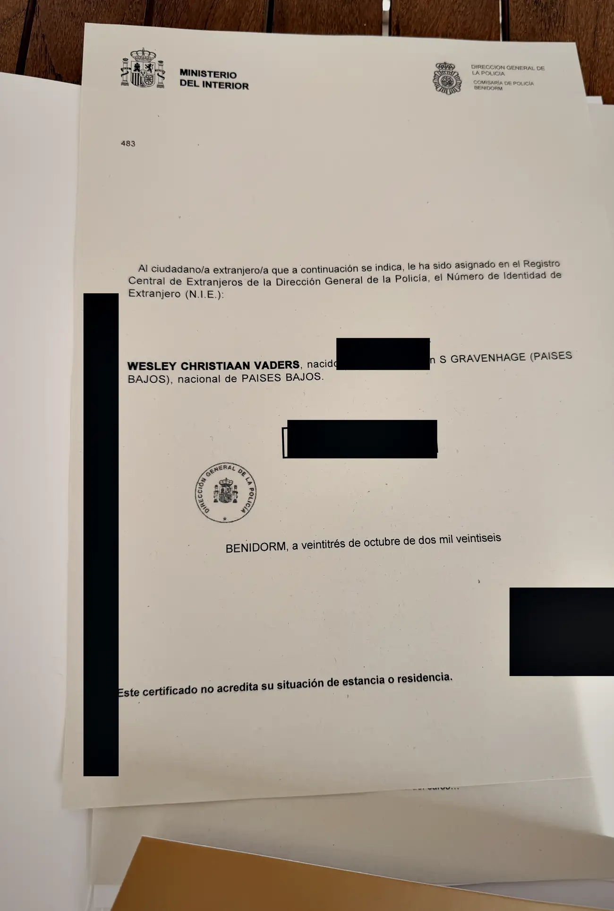

Het is vrijdag. Alweer. Ik ben hier nu zo'n 4 weken en ik heb nog steeds het gevoel dat ik stilsta, maar als ik terugkijk op deze week klopt daar helemaal niets van.

De bus staat bij de garage. Nog steeds. Verder bewoog er van alles.

## Tres rusos

Mijn monteur is een Rus. De vrouw met wie ik dinsdag ben gaan wandelen is Russisch. En de eigenaar van het huis dat ik gisteren heb bezichtigd, je raadt het al, Rus.

Normaal kom ik hier Nederlanders tegen, Noren, Engelsen en natuurlijk Spanjaarden. Deze week was het blijkbaar Rusland. Ik heb geen idee waarom. Alfaz del Pi staat juist bekend om zijn Noren, dat is hier echt een ding, en de grote Russischtalige gemeenschap zit een flink stuk zuidelijker, rond Torrevieja. Statistisch gezien heb ik dus gewoon een rare week gehad.

Mocht jij een betere verklaring hebben, ik hoor het graag.

## De vuurtoren van Albir

Dinsdag ben ik met een mooie dame wezen wandelen naar de vuurtoren van Albir. Ergens in een ver grijs verleden ben ik daar weleens geweest, maar ik kon me er niets meer van herinneren. De kans bestaat dat ik destijds de entree heb gezien en toen ben omgekeerd.

Totaal uit mijn comfortzone, met iemand die ik nauwelijks ken, heerlijk aan de wandel. Iets wat ik normaal niet snel doe, maar hé, yolo.

En het was heerlijk. Ik heb genoten. Je loopt daar over een breed pad dat langs de rotsen omhoog kruipt, met de zee honderden meters onder je en de bergen van Altea aan de overkant van de baai. Op zo'n moment weet je weer even waarom je zo gek bent op bergen.

Daarna hebben we nog een klein hapje gegeten. Een vervolg is niet uitgesloten. Sterker nog, ik kijk ernaar uit.

## Bereik

Woensdag weer gewoon gewerkt. Wat vervelend is: ik heb hier slecht bereik. Via wifi gaat alles prima, maar bellen is een ding en dat maakt het soms lastig. Bellen via WhatsApp is voor mij nu de beste optie.

Zo loop je tegen dingen aan en komen er oplossingen.

## 3 – 12

Waar ik nog wél een oplossing voor nodig heb, zijn de muggen. Het is bizar. Rond een uur of 17:00 komen ze. Elk gaatje, elke bilspleet weten ze te vinden. Ik word dagelijks lek gestoken, rond dezelfde tijd.

Ik ben inmiddels een soort noodplan aan het maken en kleed me rond dat tijdstip aan als een eskimo, terwijl het ruim 25 graden is. En nóg pakken ze me, op de meest gekke en ongelofelijk irritante plekken.

Af en toe mep ik er eentje neer. Maar ik verlies dagelijks met 3–12. 3 dode muggen en 12 bulten waar de paus de hik van krijgt.

Toen ik er eentje van dichtbij fotografeerde, viel me iets op: zwart-wit gestreepte poten. Dat is een tijgermug. En dat verklaart precies waarom mijn timing steeds niet klopt. Ik ging er altijd vanuit dat muggen een avond- en nachtdier zijn, zoals thuis. De tijgermug niet. Die is overdag actief, met pieken in de vroege ochtend en de late middag.

Oftewel: ik doe mijn deur open op het exacte moment dat ze aan hun dienst beginnen.

Sorry mug, maar ik ben klaar met je.

## 15.000 vierkante meter

Gisteren had ik dan eindelijk een bezichtiging. Ik heb inmiddels 50 advertenties opgeslagen op Idealista, zeg maar de Spaanse Funda. Maar alles is toch best ver van de bewoonde wereld.

Dit was zo'n 15 minuten vanaf Finestrat, 40 minuten van Alfaz waar ik nu zit, en 20 tot 30 minuten van de stranden van Benidorm en Villajoyosa. Ik merk dat ik met mijn zoektocht toch graag in dit gebied blijf. Uren rijden naar een beetje supermarkt voelt niet lekker, al koop je daar meer voor minder.

Maar dit was eigenlijk perfect.

Het gaat om een perceel van ongeveer 15.000 m² met een woonoppervlakte van 302 m², verdeeld over 2 gebouwen en zelfs een gastenverblijf. In principe staan er dus 2 huizen op het terrein. Het ene is zo bewoonbaar, al is het nog niet echt naar mijn smaak. Het tweede, los van het eerste, moet volledig gerenoveerd worden. Daar ga ik op aan. En dat er dan al een huis bewoonbaar is, is puur luxe.

5 slaapkamers in totaal. 4 badkamers.

Ik heb mijn huis in Monster verkocht omdat het te groot was, en nu sta ik te kijken naar iets wat bijna 3 keer zo groot is. Koekoek.

Ik stond daar in de tuin, keek over het terrein en het uitzicht, en voelde een bepaalde rust door mijn lichaam heen komen. Mijn ziel wordt hier heel gelukkig van.

Alleen: het is prijzig. En dat betekent dat ik minder budget overhoud om te verbouwen en in te richten naar smaak. Het is te doen, maar niet allemaal tegelijk.

Un poco de todo.

## Drie uur 's nachts

Het heeft me vannacht goed beziggehouden. Rond een uur of 3 werd ik wakker, en dan ga ik denken. Doe ik dit wel goed. Is dit de juiste keuze. Is dit wat ik wil.

Ik ben al zo ver, en dan wordt het spannend.

Ik heb vandaag zelfs sinds lange tijd weer een beetje paniek gehad. Niet per se om die gedachten die alle kanten op gaan, maar ook omdat ik me vanmorgen vroeg in Benidorm moest melden bij het politiebureau voor mijn NIE-nummer. Midden in het centrum.

## Benidorm

Ik weet niet of je een beetje bekend bent met Benidorm, maar ik rij makkelijk door Amsterdam, Den Haag of Rotterdam en dit is andere koek. Rotondes met 3 banen. Fietsers midden op de weg. Totale chaos. Ik haat het. Of ik ben het gewoon niet gewend.

En dan kom je daar op tijd aan en mag je vervolgens een half uur wachten voordat je geroepen wordt. Allemaal bloedchagrijnig, die agenten daar.

Maar hé.

Ik heb mijn NIE.

Dat is het nummer waarmee je in Spanje pas echt bestaat. Zonder dat nummer kun je niks: geen huis kopen, geen contract tekenen, geen auto op je naam zetten. Een papiertje van een halve A4, een stempel, en opeens kan alles wat hiervoor niet kon.

## Komende week

Eindelijk vooruitgang. NIE gefikst, en de rest is weer afwachten.

In dat huis heb ik serieus interesse. Ik moet alleen een paar dingen goed uitzoeken de komende dagen voordat ik overhaaste beslissingen neem. Er zitten nog wat haken en ogen aan, zeg maar.

Mocht ik wat wijzer zijn, dan ben ik er snel weer met een nieuw verhaaltje.

Bedankt weer voor het lezen. Ik hoor graag jouw gedachten.
