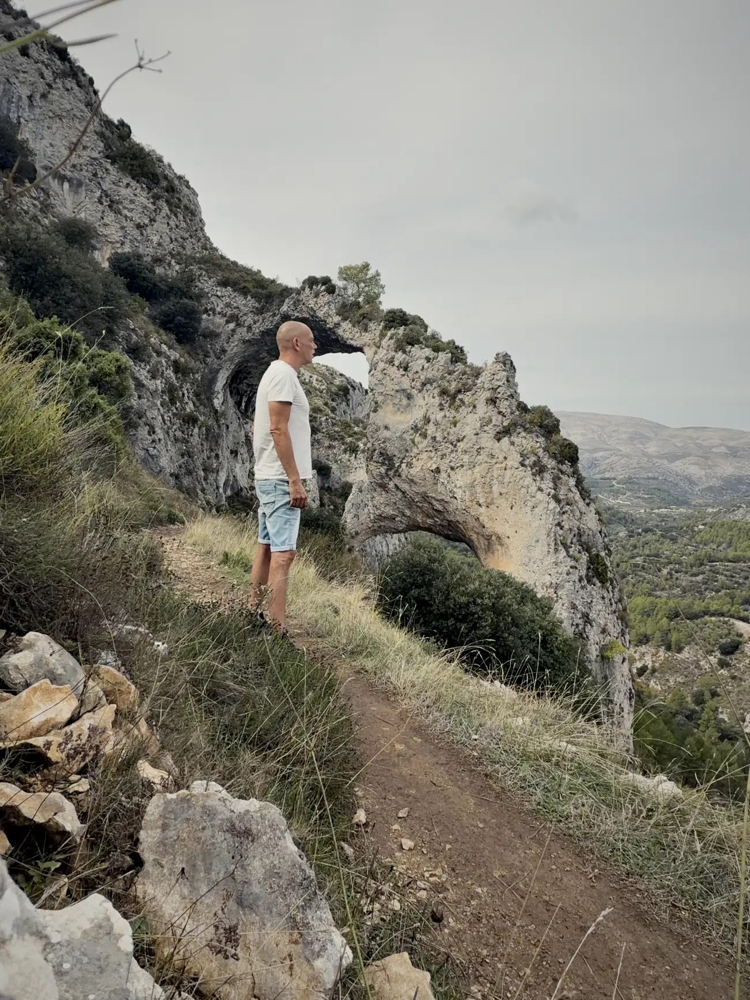
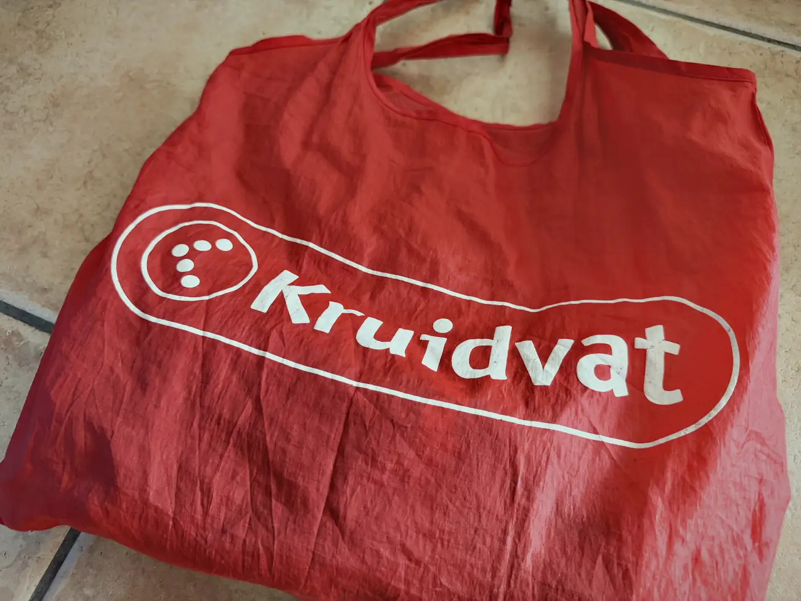
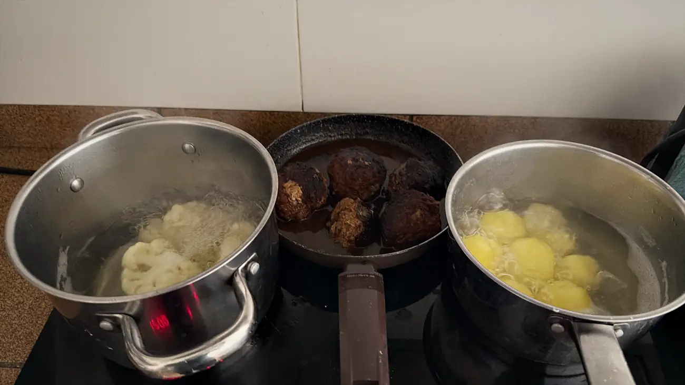
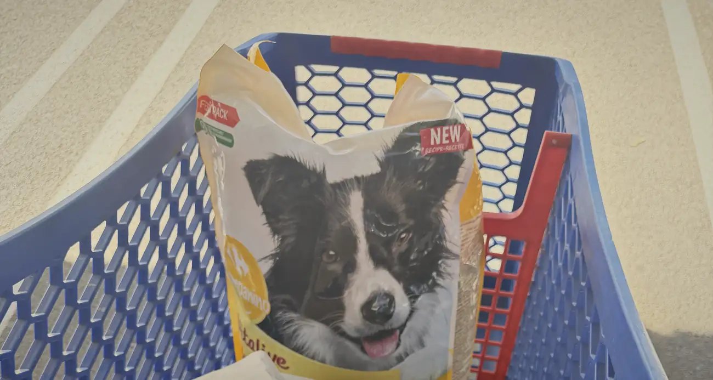
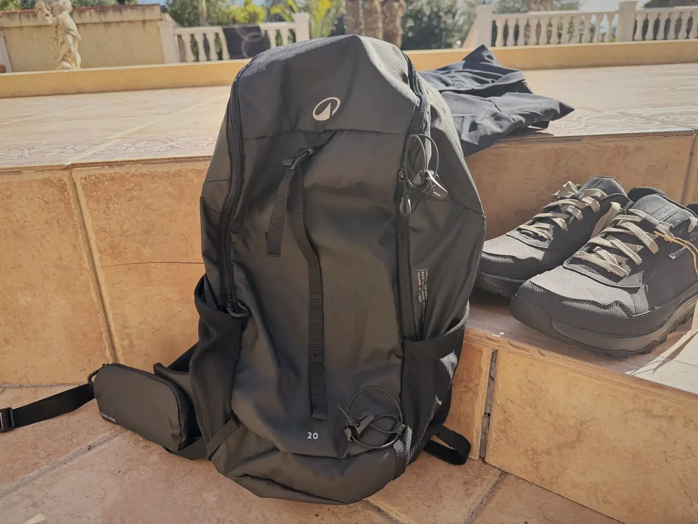
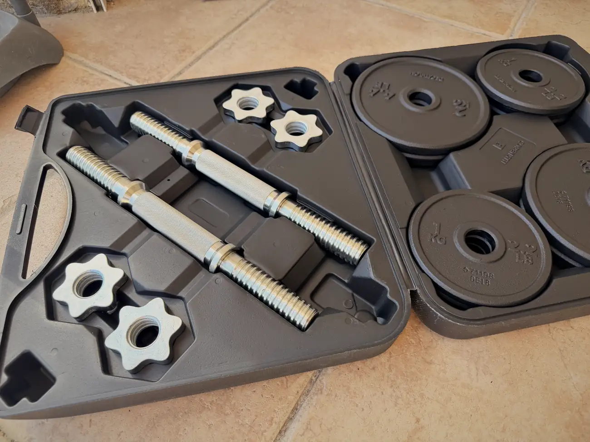

import VideoInsluiten from '../../components/VideoInsluiten.astro';
import poster from '../../../public/video/els-arcs-video.jpg';

Zondag. De weken vliegen hier voorbij. Maar ook dit weekend heb ik niet stilgezeten.

Ik ben in de auto gestapt en naar Els Arcs gereden, bij Castell de Castells. Niemand wist ervan. Sorry daarvoor, dat werd me niet in dank afgenomen.

Een wandeling van zo'n 8 km, met de nodige klim- en daalmomenten. Ik heb geen billen, maar die voel ik vandaag wel. De tandjes. Ik loop vaak, maar dat klimmen is even wennen.

## Els Arcs

Ik wist er helemaal niks van toen ik erheen reed. Ik had een naam en een plek op de kaart, en ik ben gegaan.

Achteraf ben ik het gaan opzoeken. Els Arcs zijn 2 natuurlijke stenen bogen, uitgesleten in de kalksteen, en het hele gebied is sinds 2005 beschermd natuurgebied. De bergen eromheen gaan boven de 1.300 m uit. Er lopen ravijnen doorheen en overal steekt er een rotswand uit de helling. Je loopt door dennenbos en langs jonge steeneiken.

Wat me het meest is bijgebleven zijn de corrals. Dat zijn oude stenen schaapskooien, half ingestort, met hier en daar nog een waterbak of een put ernaast. Mensen hebben daar generaties lang van dat land geleefd. Nu kom je er bijna niemand meer tegen. En in diezelfde gemeente blijken rotsschilderingen te zitten die op de Werelderfgoedlijst staan.

Allemaal dingen die ik had kunnen weten als ik van tevoren had gekeken.

De route heet PR-CV 151. Bijna 8 km rond, ruim 2 uur, en op het bordje staat 168 m klimmen.

Dat bordje heb ik thuis nog eens opgezocht. Ik wilde controleren of daar echt 168 stond.

## Si ves una cruz, vas mal

Ik parkeerde bij een smal weggetje. Daar stonden 2 Spanjaarden, helemaal bepakt. Dat leken wel militairen.

Lo siento, ¿dónde está Els Arcs?

En dan gaan die Spanjaarden los. Bla bla bla bla.

¿Puedes hablar más despacio, por favor? Soy holandés y vivo aquí hace una mesa.

Dat waarderen ze. Hij lachte en begon rustig te praten.

Pas later snapte ik waar die lach vandaan kwam. Ik wilde zeggen dat ik hier een maand woon. Mes. Ik zei mesa. Tafel. Ik heb die man dus verteld dat ik hier sinds één tafel woon.

Of hij begreep me gewoon niet. Kan ook.

Hij vertelde me dat er 2 routes naar de bogen lopen, de een wat langer dan de ander. Ik heb ze allebei gedaan: heen de lange, terug de korte.

En hij gaf me het beste advies van de dag. Volg de witte en groene strepen. Zie je ergens een kruis, dan ga je verkeerd.

Claro. Muchas gracias.

Toen vroeg hij of ik water bij me had.

Sí, mira.

En toen keek hij. Naar me rode Kruidvat-tasje. Naar me korte broek. Naar me The Dude-gympies.

Zij stonden erbij alsof ze op het punt stonden een gijzeling te beëindigen.

¡Aquí! Deze is voor jou, neem maar wat extra water mee.

Die man en die vrouw maakten zich serieus zorgen om mij.

## Zo'n maffe Hollander

Bij de wat heftigere stukken omhoog begon ik die man steeds beter te begrijpen.

Hij heeft daar staan denken: daar heb je weer zo'n maffe Hollander.

En gelijk had hij. De route was heerlijk rustig, ik kwam bijna niemand tegen, en de enkelingen die ik wel tegenkwam waren aan het hiken. Met van die stokken. Heel fanatiek.

Dat deed ik met me selfiestick.

Zij prikten zich omhoog. Ik filmde mezelf omhoog. Ik weet niet wie van ons er beter uitzag, maar ik weet wel wie er bovenaan nog water overhad, en dat was ik niet, want dat had ik van iemand anders gekregen.

## De camera

Ik heb een mooie camera gekocht. Met microfoon en alles.

En je raadt het al. Mensen die mij een beetje kennen weten dat ik dan helemaal doorsla en er vervolgens niks meer mee doe.

Maar gisteren heb ik hem voor het eerst echt gebruikt. Ik heb er een kort filmpje van gemaakt en op YouTube gezet. Ik heb nog een hoop te leren qua monteren, maar ik wil dit vanaf nu vaker gaan doen. En zulke wandelingen ook.

Op dat soort momenten realiseer ik me hoe dankbaar ik ben dat ik dit gewoon kan doen, wanneer en waar ik maar wil. Dan kom ik even helemaal tot mezelf. Met mezelf. In het hier en nu.

<VideoInsluiten
  id={frontmatter.insluiting.youtubeId}
  titel={frontmatter.insluiting.titel}
  duur={frontmatter.insluiting.duur}
  poster={poster} />

## Hollandse pot

Terug in Alfaz kreeg ik trek. Nog even snel naar de SuperCostaBlanca, de Jumbo 2.0, en ja hoor.

Hollandse pot. Gehaktballen, aardappelen en bloemkool.

Sommige dingen veranderen dus niet.

## De boodschap was duidelijk

Nadat de video online stond kwamen de reacties binnen. Over mijn schoenen. En over mijn tasje.

Dank daarvoor trouwens. Ik vind het echt leuk en het motiveert me enorm.

Maar in combinatie met die blik van die 2 Spanjaarden was de boodschap wel duidelijk. Ik moest me uitrusting aanpassen.

Eerst naar de Carrefour in Finestrat. Hondenvoer, wat boodschappen, een nieuw kleedje voor Mo en een dikke hamburger voor vanavond. Daarna ben ik nog even bij de rugtassen en de schoenen gaan kijken, maar ik kreeg een nehhh-momentje. Dit wordt hem niet.

Even op Google Maps gekeken waar de dichtstbijzijnde Decathlon zat. 350 m. Top.

En daar ging het bijna weer helemaal mis.

Ik kwam binnen voor een tas en een paar schoenen. Een tas en een paar schoenen. Dat was de hele opdracht.

Ergens tussen de wandelsokken en de drinkflessen ben ik dat uit het oog verloren, want toen ik bij de tenten aankwam had ik een complete kampeeruitrusting in me kar staan.

Bij die tenten kwam er een stemmetje. Nee Wes. Je kwam voor een rugtas en schoenen. Je hebt nu een kar alsof je 4 maanden het veld in gaat.

Dus ik heb alles maar teruggelegd. En een iets goedkopere tas gepakt, die ik in eerste instantie trouwens ook al in me kar had.

Wat ik er niet meer uit kreeg was een broek met afritsbare broekspijpen. Ik dacht, dat is toch wel handig, die kan mee in me tas als ik weer ergens door de prikkelzooi loop.

En een halterset.

Die was te zwaar. Kreeg ik niet uit me kar.

Gekheid. Ik wil gewoon wat meer gaan bewegen. Ik had me voorgenomen om 's ochtends vaker naar Albir te rijden, want daar staan van die sporttoestellen op het strand, maar daar komt het niet van. Dus ik ga het trainen weer zelf oppakken. Thuis. Zoals ik het altijd heb gedaan.

## Vandaag

Vandaag hou ik het even voor gezien. Ik ga zo nog een uurtje in het zonnetje zitten, straks me Angus burger bereiden, en vanavond lekker de Grand Prix van Amerika kijken, met Max op de 2e plaats in de grid.

Bedankt weer voor het lezen. En voor het kijken, als je de video hebt gezien.

Er staat ook een korte versie <a href="https://www.tiktok.com/@wesleyvaders/video/7700227790552960289" target="_blank" rel="noopener">op TikTok</a>.

Leuk als je hieronder een reactie achterlaat, of op YouTube onder de video. Ik word daar altijd vrolijk van, en het helpt me om me mini-kanaal te laten groeien.

Dank alvast. Adiós.
