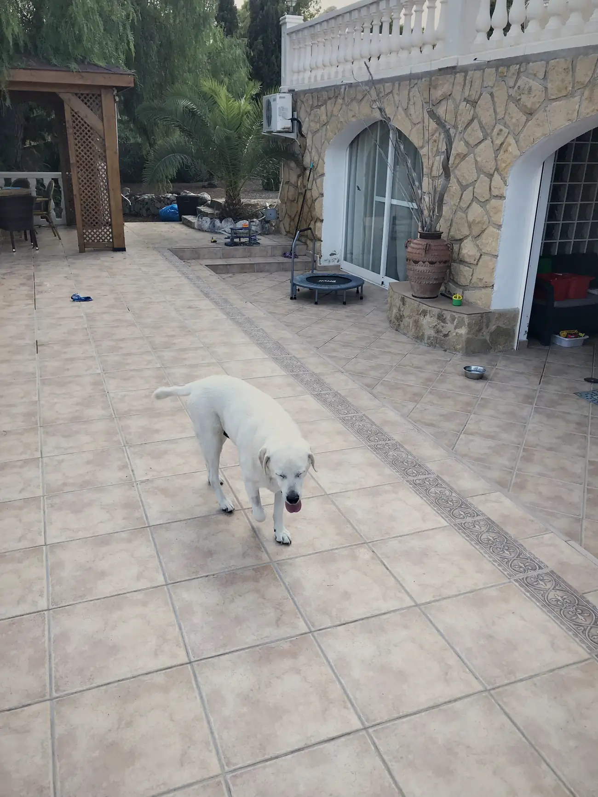
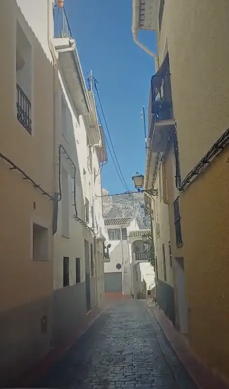
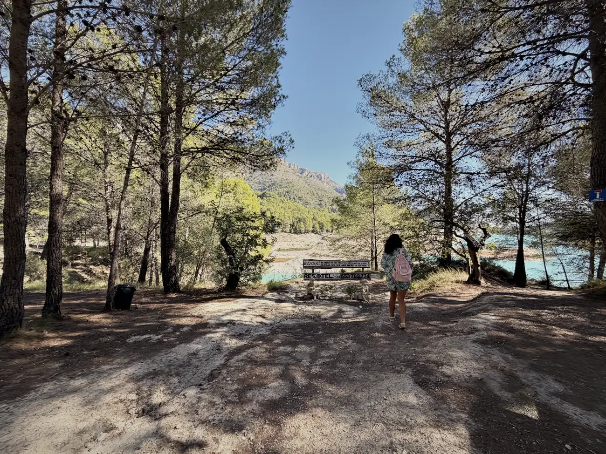
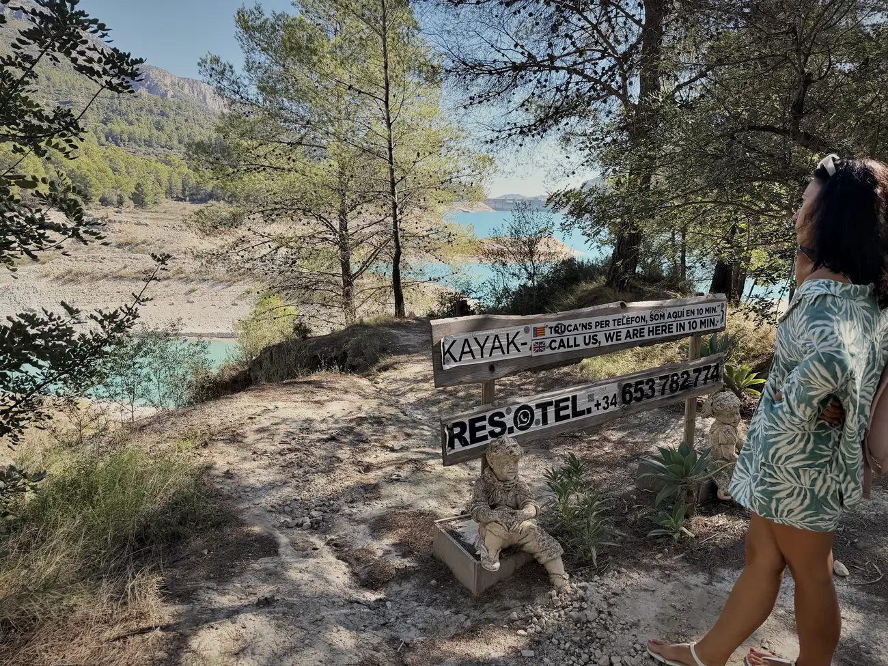
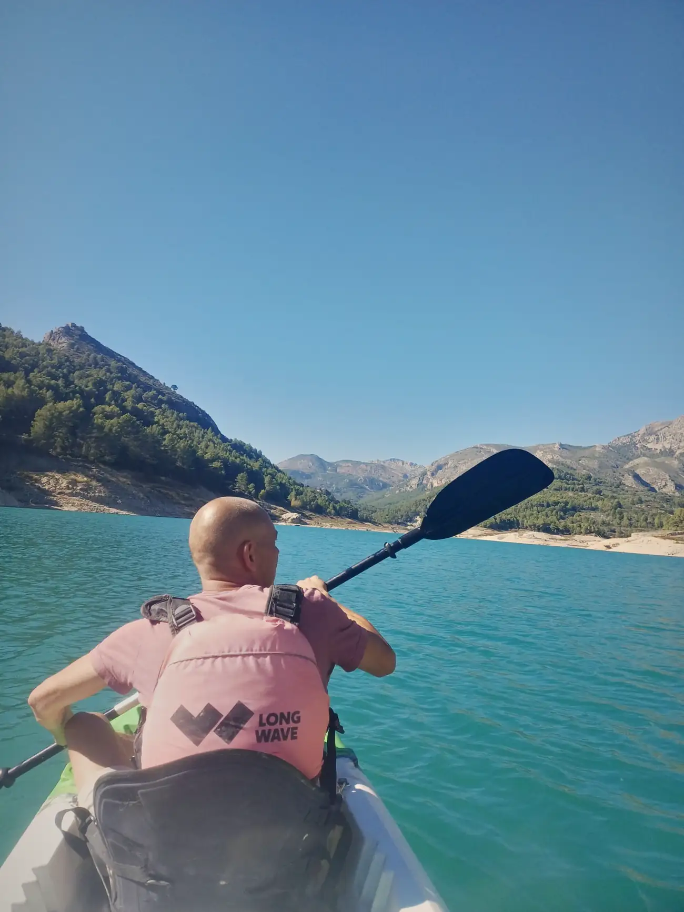
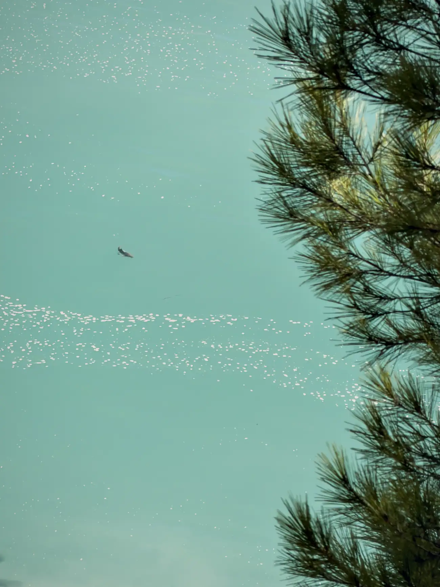
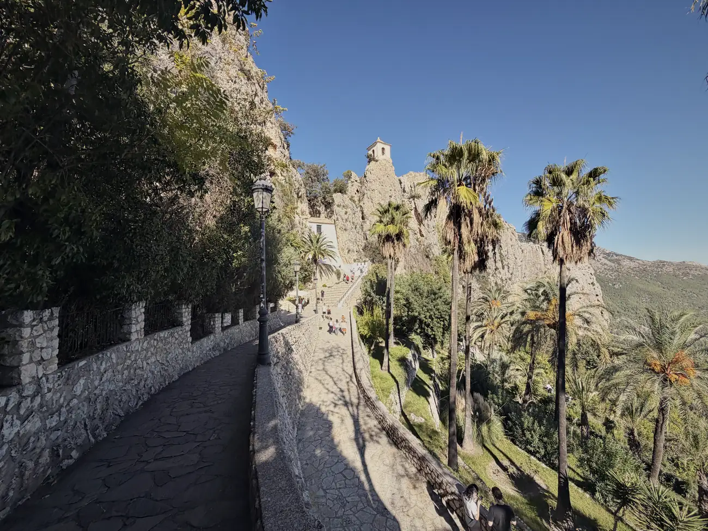

import VideoInsluiten from '../../components/VideoInsluiten.astro';
import poster from '../../../public/video/guadalest-short.jpg';

Daar ben ik weer.

Na 3 dagen last van me billen, die ik niet heb, en pijn aan zowel me schenen als me kuiten, kon ik weer een beetje bewegen.

## 27 oktober

Gisteren was een trieste dag.

Op 27 oktober 2021 is mijn moeder overleden. Door alle drukte en de zorg voor mijn vader heb ik toen niet echt de ruimte gehad om daar om te rouwen, denk ik.

Die kwam gisterochtend even binnen. Alles komt dan weer als een film voorbij, en hier in Spanje kwam dat even hard aan.

Ik heb het volledig omarmd. Traantjes weggepinkt. En dan heb je 2 keuzes. Bij de bakken neerzitten, of er het beste van maken.

Er is maar 1 waarheid. Maar hoe je daarnaar kijkt en hoe je ermee omgaat, dat is aan jou. Ik had de hele dag als een verslagen hond rond kunnen lopen, maar daar heb ik alleen mezelf mee.

Vamos. We gaan naar Guadalest.

## Allemaal gekke lijntjes

En dat was eigenlijk het mooiste van de hele dag.

Een vriendin kwam met dat idee, zonder te weten hoeveel herinneringen ik daar heb liggen. Guadalest is een toeristische trekpleister, dus daar had zij natuurlijk geen benul van.

Ik ben daar zo vaak geweest dat je het niet wilt weten. Met mijn ouders. De laatste keer nog met mijn vader. We hebben daar toen foto's gemaakt. Dat was in 2018, 8 jaar geleden.

Die foto's kan ik helaas niet meer vinden. Maar ik vond wel een foto van Bo, mijn vorige hond. Diezelfde tegels, hetzelfde terras. Waar nu de bruine versie rondloopt.

Allemaal gekke lijntjes die gebeuren. Maar het voelt alsof het zo moet zijn. Die dag, die plek, en ik hier op dit moment. In het hier en nu.

## Het dorp waar je net niet doorheen past

Kajakken bij Guadalest. Nooit gedaan, dus ik denk wel dat ik het kan.

Guadalest zelf heb ik na al die jaren vakantie hier wel gezien. Maar over dat meer varen leek me wel wat. Hop, die auto in en gaan. Maak er een mooie dag van.

De route erheen ken ik. La Nucia, Polop. Heerlijk om te rijden.

Maar naar beneden, naar het meer, dat was onbekend terrein. Je rijdt dan door een dorpje waar je het Spaans benauwd van krijgt. Zo smal dat je er met een gewone personenauto bijna niet doorheen komt.

Terug was geen optie. De weg was naar beneden.

En dan denk je nog maar aan 1 ding. Als ik maar geen tegenligger krijg.

En ja hoor. Wat je aandacht geeft, groeit.

Lichtelijk in paniek, zweterige handjes, maar ook dit komt goed. Een klein stukje achteruit gereden, en de Spanjaard die ik tegenkwam was een local, die wist daar wel mee om te gaan. Propte zijn auto in een voor mij onmogelijk steegje, en voilà. Ik kon weer door.

Nu maar hopen dat de weg terug via een andere route zou gaan. Maar dat laat ik voor nu even los.

## Pak maar een kajak, we zien je later

Enigszins overprikkeld beneden aangekomen stonden we bij de kajakmensen.

Daar staat een bord met een telefoonnummer, en daarop staat dat ze binnen 10 minuten bij je zijn als je belt.

Nou, je raadt het al. Die nemen niet op.

Die zaten zelf op het water, in een zeilbootje. Toen we naar beneden liepen, probeerden we het nog een keer, en dan hoor je serieus zijn of haar ringtone afgaan. Dan maar op het geluid af.

Op tafel lag een briefje. Pak maar een kajak, we zien je later.

Echt weer Spaans, dit.

Maar hé, ik heb dit nog nooit gedaan. Ik was mezelf al half aan het installeren toen de verhuurders kwamen aanvaren met hun zeilbootje. Zo toch nog een kleine instructie gehad, en gaan.

## Op het water

Kajakken.

Het was fantastisch weer, geen zuchtje wind. Mooie vissen te zien vanaf het land. Prachtig uitzicht. Ideaal als je het nog nooit gedaan hebt: glad water en no pasa nada.

We hebben een uurtje heerlijk rondgedobberd. Nog 1 vis zien springen. En vooral onwijs genoten van dit uitzicht en van de hele ervaring.

Helemaal in het hier en nu. In de stilte.

Totdat een groep Spanjaarden hetzelfde idee had. Die praten zo hard dat je ze in Benidorm kon horen.

Maar ik klaag niet. Het was heerlijk.

<VideoInsluiten
  id={frontmatter.insluiting.youtubeId}
  titel={frontmatter.insluiting.titel}
  duur={frontmatter.insluiting.duur}
  verhouding={frontmatter.insluiting.verhouding}
  poster={poster} />

## Weer omhoog

Na het kajakken natuurlijk weer omhoog, door diezelfde nachtmerrie.

En verrek. Weer een tegenligger.

Nu was ik gelukkig degene die iets makkelijker kon steken. Maar je raakt echt goed benauwd in die straatjes. De navigatie heeft daar weinig tot geen ontvangst en er staan geen bordjes. Ik word daar niet vrolijk van.

Ik zou bijna zeggen: geef mij Benidorm maar.

Maar eerlijk gezegd is dit ook gewoon een avontuur. Zoiets vergeet je niet zo snel. En ik heb een flauw vermoeden dat dit niet de laatste keer is, dus ik moet er maar aan wennen.

## Boven, waar ik al zo vaak stond

Daarna toch nog even naar boven gereden, naar het beruchte Guadalest.

Ik ken het. De leuke winkels, de museumpjes, de fotografen die je een sleutelhanger willen verkopen. Been there, done that.

Maar deze keer heb ik me er voor 100% aan overgegeven. Ik moet hier zijn, vandaag.

En ik voelde dat die oudjes van me bij me waren.

## En vandaag

Wat begon met een traan, eindigde met een lach.

Hiervoor ben ik gekomen. Dit wil ik vaker doen.

Het normale leven gaat ook door, dus vandaag gewoon gewerkt. En vanmorgen kreeg ik een berichtje van de makelaar dat het huis in Sella onder voorbehoud is verkocht.

Dit mocht dus niet zo zijn.

Vandaag contact gehad met een andere makelaar in Albir, en zij gaat haar best voor me doen. Keep you posted.

Bedankt weer voor het lezen. Abonneer je even op mijn YouTube of op een van mijn andere kanalen als je dat nog niet gedaan hebt, of laat hieronder een reactie achter. Ik waardeer het enorm en het motiveert me echt.
