Vrijdagavond.

Ik heb vorige week aardig wat dagen binnen gezeten. De tuinmannen waren hier bezig en vonden het een strak plan om een container pal voor mijn voertuig te zetten.

Gelukkig had ik een scooter tot mijn beschikking. Daar deed ik al dagen mijn boodschappen mee, maar echt veel rijden met dat ding wilde ik niet. Ik weeg niet zoveel. Dat ding het dubbele van mij.

Rijden is het probleem niet, die gaat als de brandweer. En er is een stukje van mij dat daar stiekem van geniet.

Gaan met die banaan.

Sinds woensdag ben ik druk aan het werk en dat is goed. Ik zit de laatste 1 à 2 weken lekker in mijn energie en ik begin hier te landen. Ik maak mooie uitstapjes en ik kan daar enorm van genieten. Maar er moet ook gewoon gewerkt worden.

Alleen voelde ik vrijdag dat ik er even uit moest.

## De Mix

Mijn oude buurman Leon een berichtje gestuurd. Boerman, zo noemen wij elkaar al jaren, en dat blijft gewoon boerman.

Hé boerman, ben je in Albir? Wat doe je?

Ja, ik ben in Albir. We zijn nog thuis, gaan zo even naar de Mix.

De Mix? Waar is dat?

Naast Lo No Sé, de bar van een vriend van mij.

O, is dat waar die ijszaak heeft gezeten?

IJszaak? Nee man, gewoon het trapje af.

Ik ken daar geen trapje. Stuur me je locatie, ik kom eraan.

Snel wat gegeten en hop, op die zware klotescooter naar Albir. Wel snel.

En dan die scooter ergens veilig neerzetten. Alles vol, overal van die linke plekjes. Echt Spanje.

Tot ik daar de vrouw zie staan van iemand die inmiddels een vriend van me is.

Hé D., wat doe jij hier? Ja, ik wacht op F., die is onderweg. Ik dacht al dat ik je zag maar ik kon het me bijna niet voorstellen.

Haha, snap ik. Ik heb afgesproken met mijn oude buurman bij de Mix, weet jij waar dat is?

Daar gaan wij ook heen. Zet je scooter maar hier op de stoep, daar staat hij veilig, dat doen wij ook altijd.

Ruim 10 jaar geleden woonden Leon en ik naast elkaar in Oud-Rijswijk. We hebben altijd contact gehouden, en nu woont hij vlak bij waar ik verblijf. Zo leuk om elkaar daar te zien.

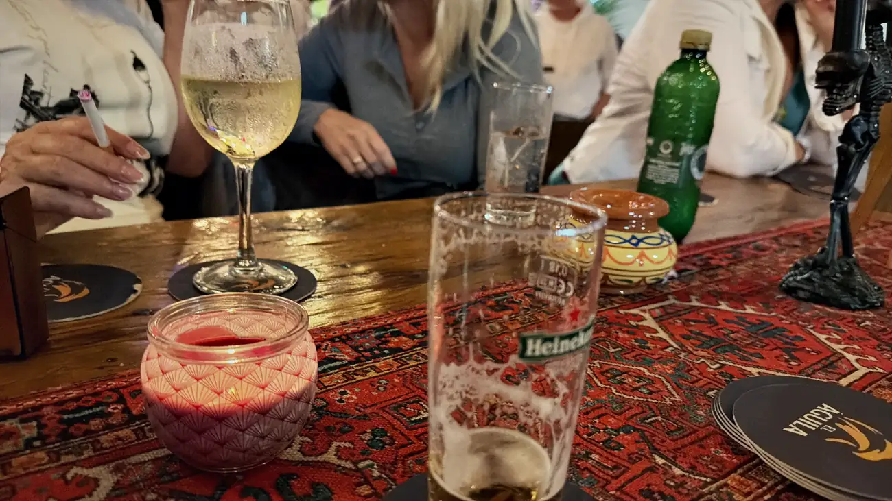

Het was druk. Veel mensen, vooral Nederlanders, en overal van die gekke kleine lijntjes. Ken je hem niet? Die kwam daar altijd. O verrek, dan ken jij die en die vast ook.

Voordat je het weet ben je uren verder. Beregezellig.

Maar ik had de volgende ochtend een afspraak met mijn Russische chica om de rots van Calpe op te lopen, de Peñón de Ifach.

Una más.

Iets te laat vertrokken. Maar net op tijd om zaterdag fris en fruitig aan de wandel te gaan.

## Niet Calpe, maar Xàtiva

Onderweg naar Calpe was het rond Benidorm nog redelijk. Maar hoe verder we reden, hoe harder het begon te regenen.

Zo kunnen we die berg niet op. Het is na het tunneltje een vrij pittige klim, en als het glad is en bewolkt is dat niet de dag om het te proberen.

We kunnen ook naar Xàtiva, daar staat een kasteel en daar kunnen we lopen. Volgens de weerapps was het daar droog.

1 uur en 3 kwartier verder begon het alleen maar harder te regenen.

## Een kasteel in de stromende regen

We zijn daar door dat kasteel heen gerend.

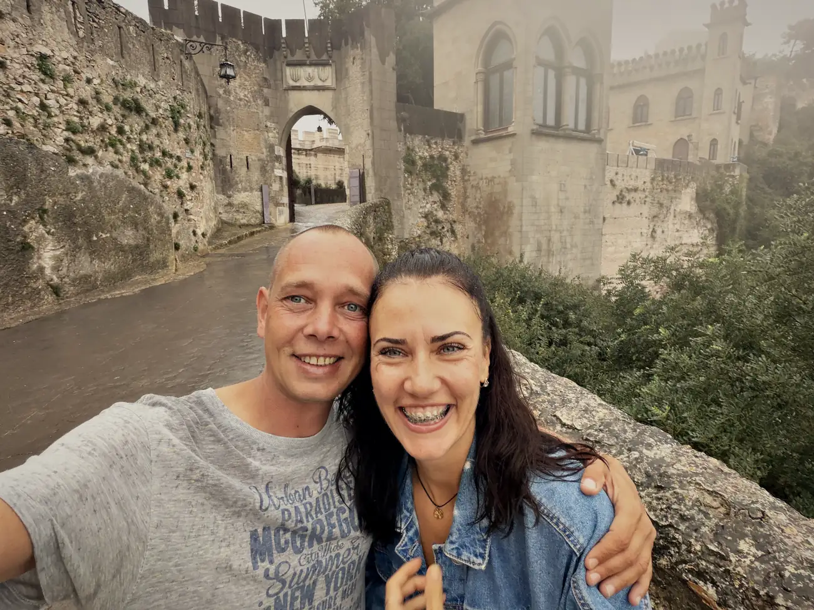

Pleuriskoud. Ik natuurlijk weer in me korte broek, met klote schoenen. Maar hé. Been there, done that.

En dat is zonde, want het is echt een prachtig kasteel. Het zijn er eigenlijk 2 op één bergkam, 310 m boven de stad. Het kleine is het oudste en staat op Iberische en Romeinse resten, het grote is middeleeuws. Hannibal zou daar zijn aanval op Sagunto hebben zitten uitdenken, en zijn zoon is er geboren. 218 voor Christus.

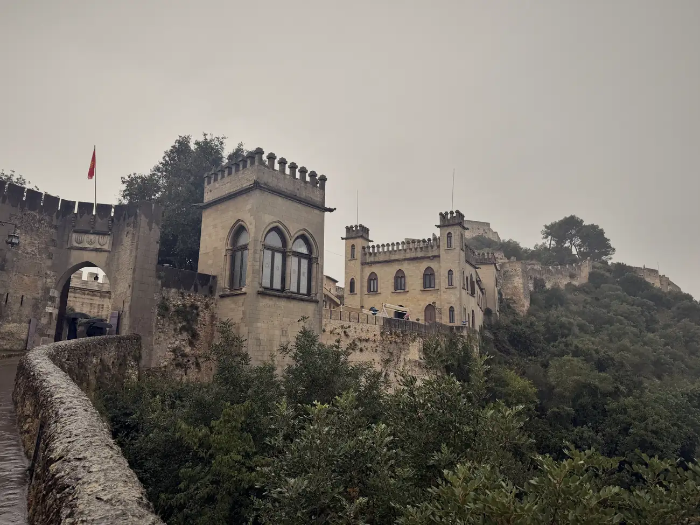

Maar het mooiste verhaal is van veel later.

In 1707 koos Xàtiva in de Spaanse Successieoorlog de verkeerde kant. De stad hield het wekenlang vol, ook nadat de muren al doorbroken waren, en Felipe V liet haar daarna platbranden. Van ongeveer 12.000 inwoners bleven er zo'n 400 over. De stad werd zelfs omgedoopt tot Colonia Nueva de San Felipe en kreeg haar eigen naam pas in 1832 terug.

En beneden in de stad, waar ik doorheen ben gereden, hangt in een museum het portret van Felipe V.

Ondersteboven.

Dat hebben ze in 1940 zo opgehangen en zo blijft het hangen tot een Bourbon-koning zijn excuses aanbiedt. De inwoners heten daar nog steeds de socarrats, de verbranden.

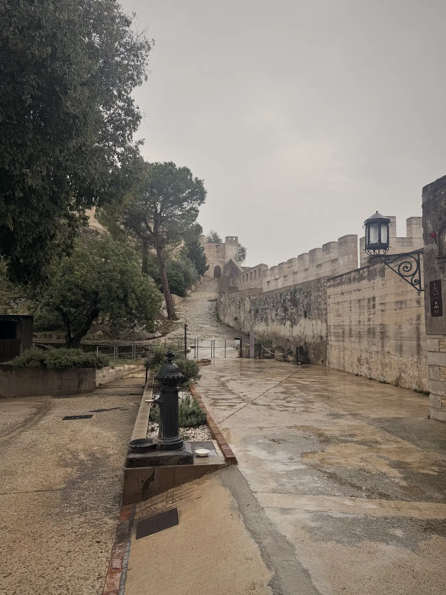

319 jaar wrok, uitgedrukt in een schilderij dat op zijn kop hangt. Daar kan ik wel wat mee.

Best een druk stadje trouwens. Maar het zat die dag gewoon niet mee.

## Een half uur van Chella

En toen keek ik op mijn navigatie.

Nog maar een half uurtje rijden naar Chella. Daar wonen 2 van mijn beste vrienden. Ze waren eerst naar Finland vertrokken en kwamen uiteindelijk later in Spanje terecht dan ik.

Ik ken ze van de hypno-opleiding. Ray was mijn medestudent, Dees was mijn lerares energetische therapie. Mensen die diep in mijn hart zitten.

Alleen was Dees er niet, die zat in Nederland en kwam de volgende dag pas terug. Sorry schat, ik kom snel weer.

Met mijn knuffelbeer Ray heb ik wel even geknuffeld. Ook dat is een verhaal waar ik nog een heel hoofdstuk aan kan wijden, want wij hebben op die opleiding heel wat af moeten knuffelen. Voor iedereen die daarbij was: ja, jullie pissen nu weer in je broek.

Daarna terug naar Alfaz. Bijna 2 uur. Door de bergen, en vooral door de regen.

Nog snel een boodschap gedaan, een hapje gegeten, en toen ging het lampje vrij snel uit. We hadden zondag een herkansing. Batterij opladen en morgen weer een dag.

## Coll de Sacarest

Mijn inmiddels partner in crime stelde voor om Calpe opnieuw te proberen, maar de kans was groot dat het daar nog nat zou zijn, en dan is dat laatste stuk tricky.

Bovendien moest ik zondag nog wat wasjes draaien en schoonmaken. Dus zocht ik iets korters. Wat opgezocht in de buurt van Sella en Finestrat, zodat we daarna nog even langs de Carrefour konden voor boodschappen en schoonmaakzooi.

Google Maps, recensies zagen er goed uit. Vamos.

Weer geen idee waar ik heen ging of wat ik kon verwachten.

Na een halfuurtje rijden kom je bij een soort paal waar je niet verder kunt. Dus parkeren. En daar was ik eerlijk gezegd blij mee, want dat weggetje ernaartoe heeft me een half jaar van mijn leven gekost. Zo smal, zo hobbelig, zo ruig.

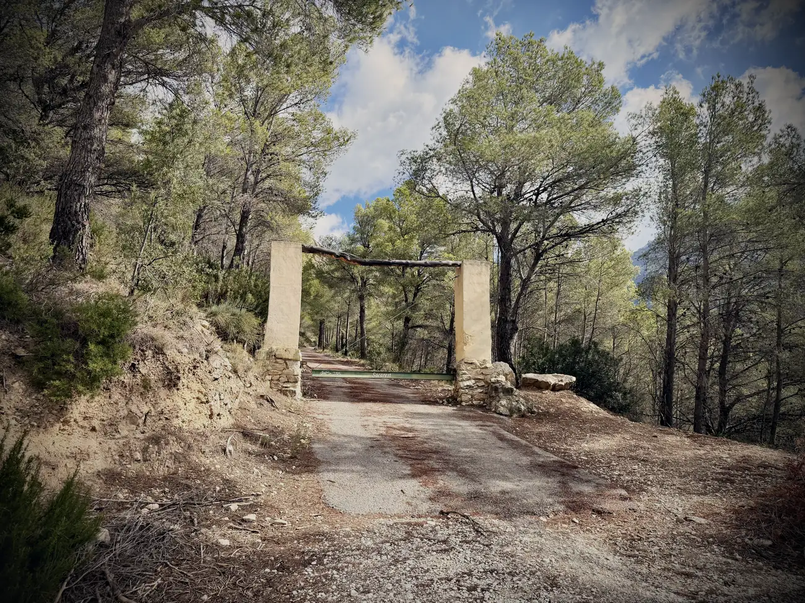

Als ik maar geen tegenligger tegenkom.

Dat gebeurde deze keer gelukkig niet. De weg was al erg genoeg.

Waar ik achteraf pas achter kwam: die Coll de Sacarest ligt op 706 m en zit precies ingeklemd tussen 3 bergen. De Serra dels Castellets met die gekartelde tanden, de Puig Campana, en de Sanxet van 895 m.

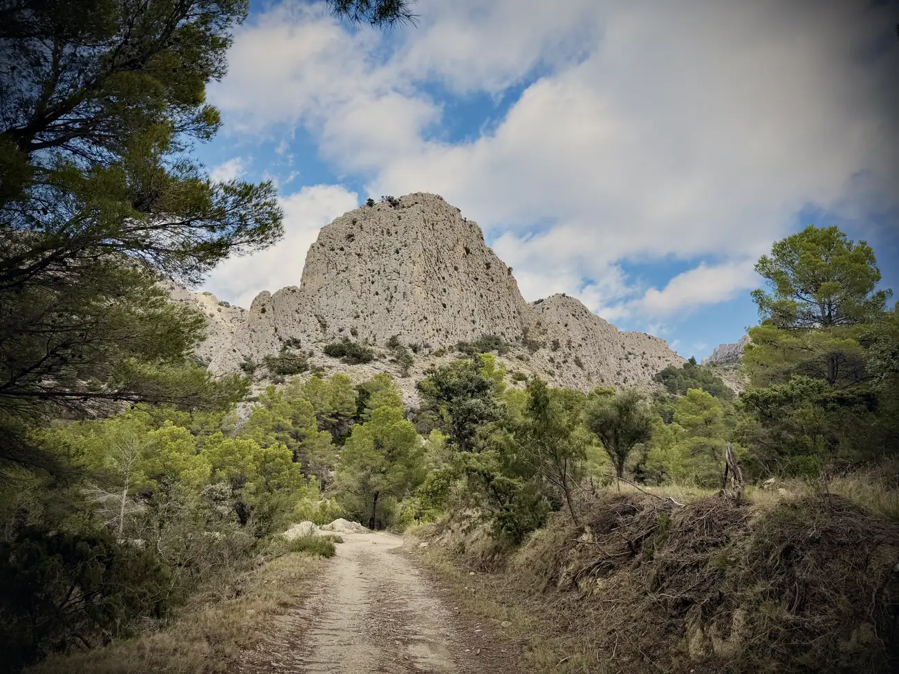

Dat verklaart waarom het daar om de zoveel meter een compleet ander landschap is.

## Mijn wandelschoenen zijn nog steeds nieuw

Ik had ze mee. Niet aan.

Zal ik me wandelschoenen aandoen?

Mijn lieftallige medereizigster keek me aan alsof ik Duits sprak. Huh? Ja, Duits. Zij spreekt Russisch, Spaans en redelijk Engels. Ik Nederlands, een beetje Spaans en redelijk Engels. Dat leidt af en toe tot de nodige onduidelijkheid.

Maar dit was een duidelijke nee.

Oké. Me The Dude-gympen aan en gaan.

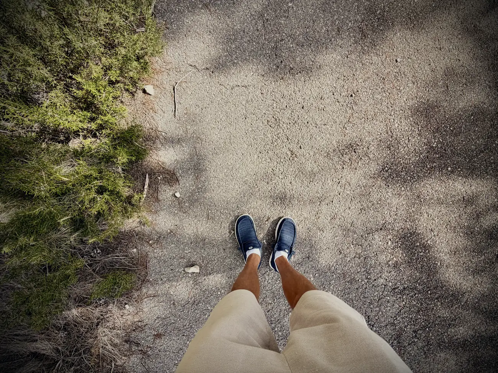

Mijn wandelschoenen zijn dus na een week nog altijd nieuw.

## Omhoog

Vorige keer had ik na 10 minuten spijt. Nu na 5.

Die eerste klim was pittig. En ik ben een paar keer bijna plat gereden door een fietser. Maar wat een route, en wat een uitzicht.

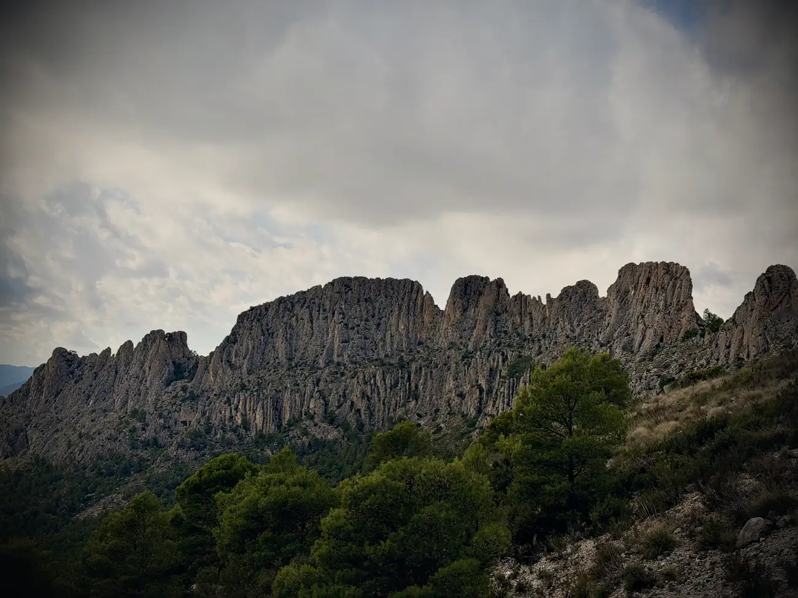

Wat opvalt is dat de natuur en de temperatuur daar om de zoveel meter veranderen. Het ene moment heb je het koud, het volgende ga je kapot van de hitte. Nieuwe les: neem meer kleren mee. Want ja hoor, ik ging weer in me korte broek en op gympen een wandeling doen van weet ik veel hoe lang.

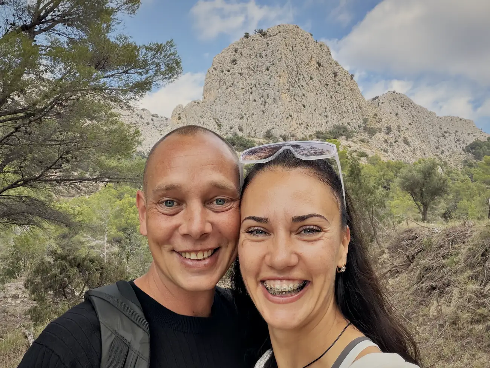

Het eerste stuk is nog geasfalteerd, maar al snel kom je in ruiger terrein. Ik voelde mijn enkels alweer. Maar ik ga me nu niet laten kennen.

En ondanks dat er geen einde leek te komen aan die route, heb ik adembenemende uitzichten gehad. Ik heb in 1 route zoveel verschillende omgevingen gezien, alle soorten bomen. Af en toe leek het zelfs even op Nederland, alleen dan niet zo vlak.

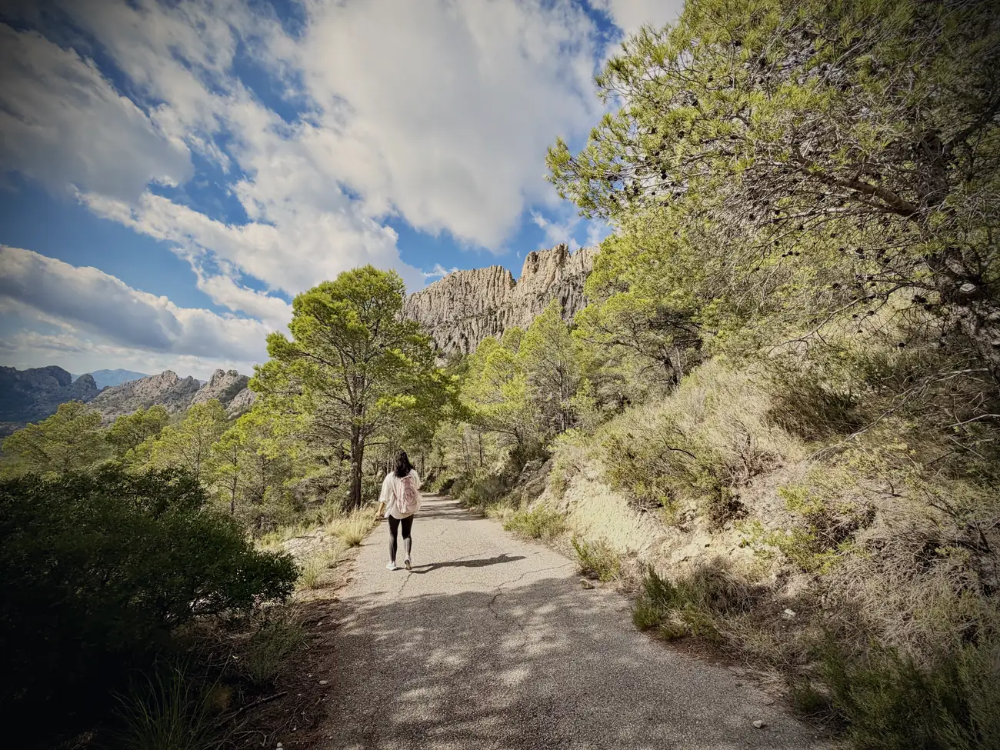

Ik heb me de schompes geklommen. Al viel het volgens mijn app nogal mee: 7,59 km en 197 m omhoog. Moeilijkheidsgraad: makkelijk.

Dank je wel, app.

Moe en voldaan weer die berg af.

De eerste weken had ik moeite met landen. Nu ga ik als een jekko. Hier ga ik op aan.

## De hap uit de berg

En toen pas viel het kwartje.

Die berg waar ik achterlangs heb gelopen is de Puig Campana. 1.406 m, de op een na hoogste van de hele provincie. En dat is de berg met de hap eruit.

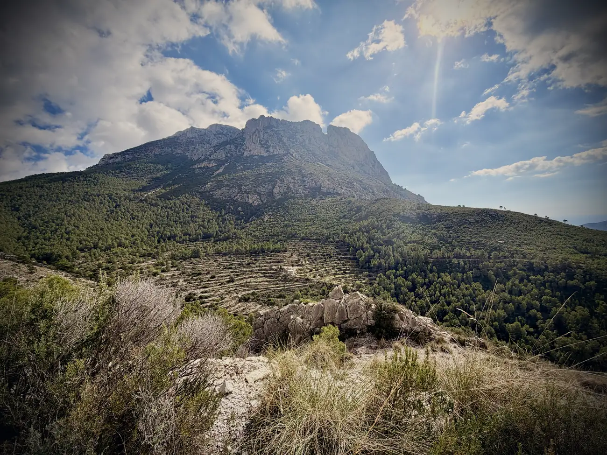

Daar keken wij vroeger met het hele gezin naar. Elke vakantie weer, vanaf de kust. Die berg met dat stuk eruit.

Nu heb ik hem van de andere kant gezien.

Die kerf heet officieel El Portell, maar hier noemt iedereen hem de Tajo de Roldán. Het verhaal gaat dat Roland daarboven vocht met de aanvoerder van het Moorse leger, uithaalde met zijn zwaard, miste, en een stuk van de berg af sloeg. Dat stuk viel in zee.

Dat is het eiland voor de kust van Benidorm.

In een andere versie sloeg hij die hap er juist met opzet uit, zodat de zon later onder zou gaan. Zijn geliefde Alda zou namelijk sterven op het moment dat de laatste zonnestraal haar raakte.

En toen is er een geoloog geweest die het is gaan narekenen. Het gesteente van de Puig Campana is Laat-Jura, het kalksteen van dat eiland is Vroeg-Krijt. Het past niet.

Iemand heeft dus serieus een legende van twaalfhonderd jaar oud met steenmonsters onderuit gehaald.

Ik hou het gewoon op Roland.

Mijn ouders zijn erbij geweest. Dat voel ik.

## En vandaag

Zondagavond gegeten en uiteraard nog even de race gekeken.

En dan is het weekend opeens weer voorbij. Vanmorgen bijzonder fris en fruitig opgestaan, productief aan de arbeid geweest, want al denken sommige mensen dat het hier lang leve de lol is, er moet ook gewerkt worden. En gesport. Dat pak ik nu steeds vaker op.

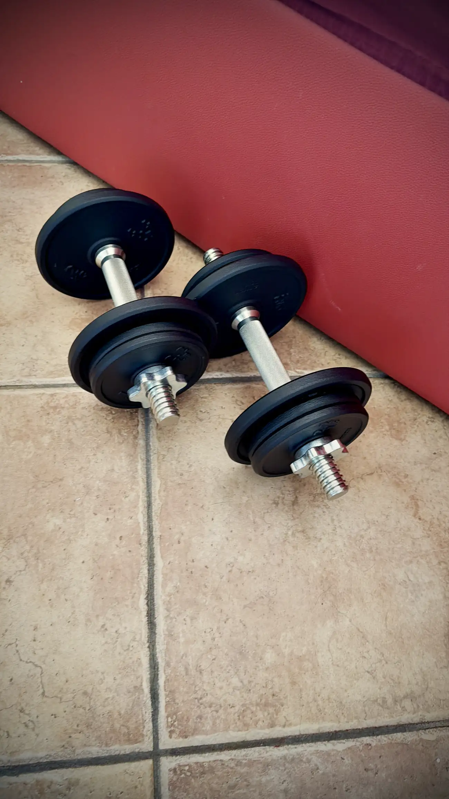

Ik voel me beter. Ik ga goed. Ik was in het begin wat aan het vechten, maar dat is nu anders. Ook dankzij mijn Russische vriendin.

Ik ben dankbaar dat ik in zo'n korte tijd zoveel mooie nieuwe mensen heb mogen ontmoeten. Maar ik mis mijn lieve connecties in Nederland ook. Gelukkig hebben we tegenwoordig genoeg manieren om elkaar online te spreken, en dat doen we ook vaak. Maar ik mis jullie allemaal.

Feit is wel dat ik hier steeds meer mijn draai vind. En daar ben ik blij mee. Ik was er met momenten even bang voor dat ik de verkeerde keuze had gemaakt.

Alles komt goed. Alles is goed.

Ik ben oké. Jij ook? Laat het me weten. Je weet me te bereiken.
