Daar ben ik weer.

Even wat later met posten dan jullie van mij gewend zijn, en dat heeft een reden. Ik was druk. Druk met bezichtigingen, druk met uitzoeken, met denken, met voelen.

Ik ben hier nu ruim 7 weken. De eerste 4 had ik het gevoel dat ik stilstond. Nu zit ik in een stroomversnelling.

En dat stilstaan was niet voor niets, want ik heb een huis gekocht.

Daarover later meer. Want het ging niet in 1 rechte lijn, en met de nodige hobbels.

## Sella

1 november. Een superleuk huis gezien in Sella. Eigenlijk 2.

Ik was enthousiast. Papieren opgevraagd, want ik dacht: eerst alles uitzoeken voordat ik iets koop. Netjes doen. Niets overhaasten.

Onthoud dat even.

## De berg op in de regen

Denken, voelen. Ik moest er even uit.

Klotenweer gehad ook, dus laten we gewoon een stukje gaan lopen. Ik met me partner in crime. Niet al te gek, want met die regen is een heftige hike geen strak plan.

Hoppa, de berg van Albir op.

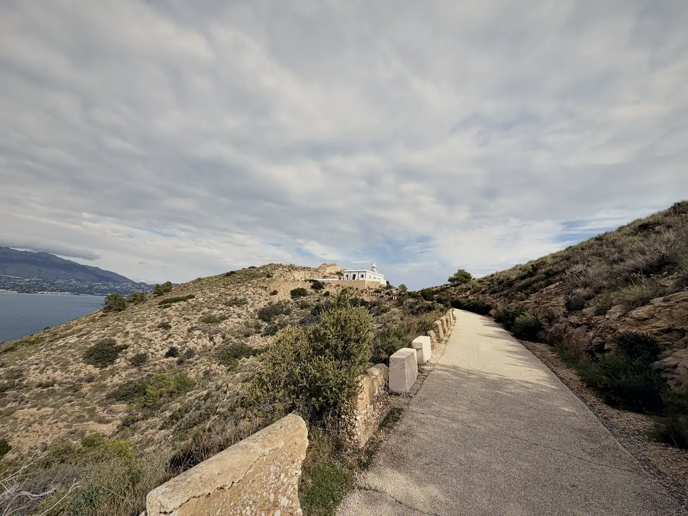

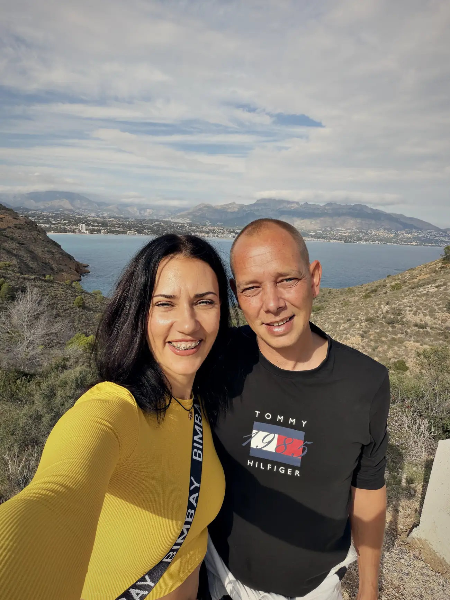

## Relleu

4 november. Na het bezichtigen van een huis bij Guadalest belde de makelaar.

Ik heb nog een soortgelijke woning, maar veel aantrekkelijker, in Relleu.

Oké, kunnen we morgen kijken? Doen we.

Relleu is een prachtig dorp. Maar dat huis was 3 keer niks. Het leek wel een kippenhok. Aantrekkelijke prijs, mooi stuk land, zelfs kans op de bouw van een nieuwe woning.

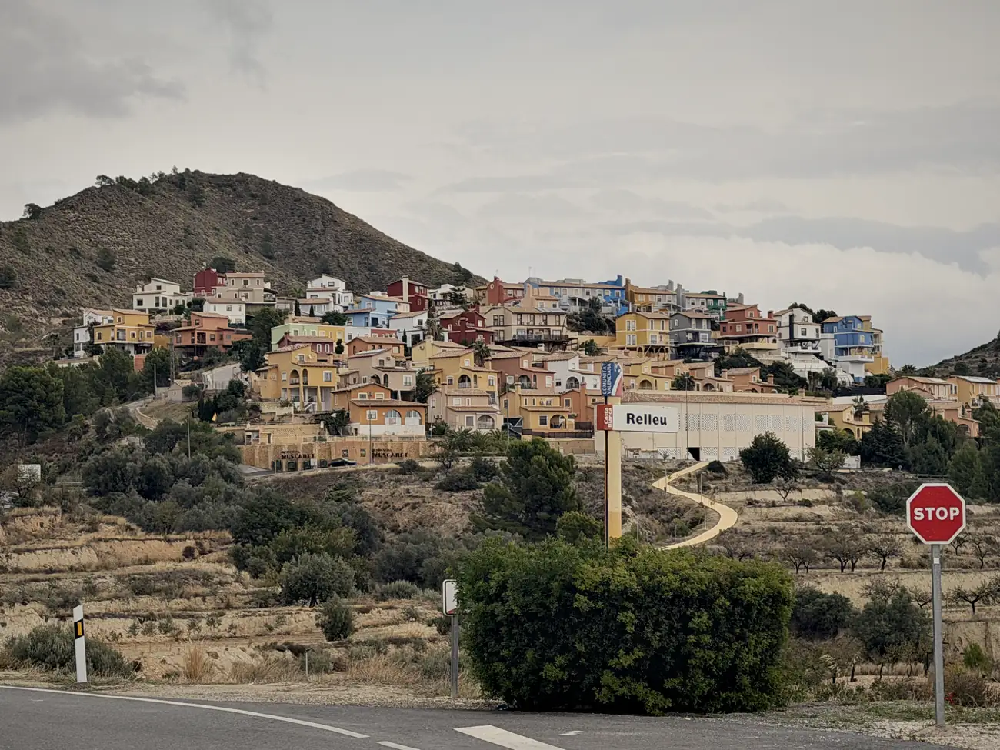

En toch weer een interne nee.

## Te laat

5 november kreeg ik de go van de gestor. Alles in orde met dat huis in Sella.

En precies terwijl ik met hem aan de telefoon zat, kreeg ik een appje van de makelaar.

Het huis was onder voorbehoud verkocht.

Ik was te laat.

Daar baalde ik enorm van. Dat eerste huis was instapklaar, met een prachtig uitzicht. Er was wel heel veel werk aan de winkel en het had mijn budget voor verbouwen aardig doen kelderen, maar toch.

Ik had wekenlang stilgestaan, en nu was ik te laat.

Dan heb je 2 stemmetjes. De een zegt: sukkel, je had gelijk een bod moeten doen.

En de ander zegt: alles gebeurt met een reden.

## Bolulla

Diezelfde dag hadden we ook een afspraak met een makelaar bij Bolulla.

Superleuk huis. Groot, 2 lagen, met een gastenverblijf. Fantastisch uitzicht, 360 graden rondom. Op loopafstand van een winkel. De tuin had enorm veel potentie.

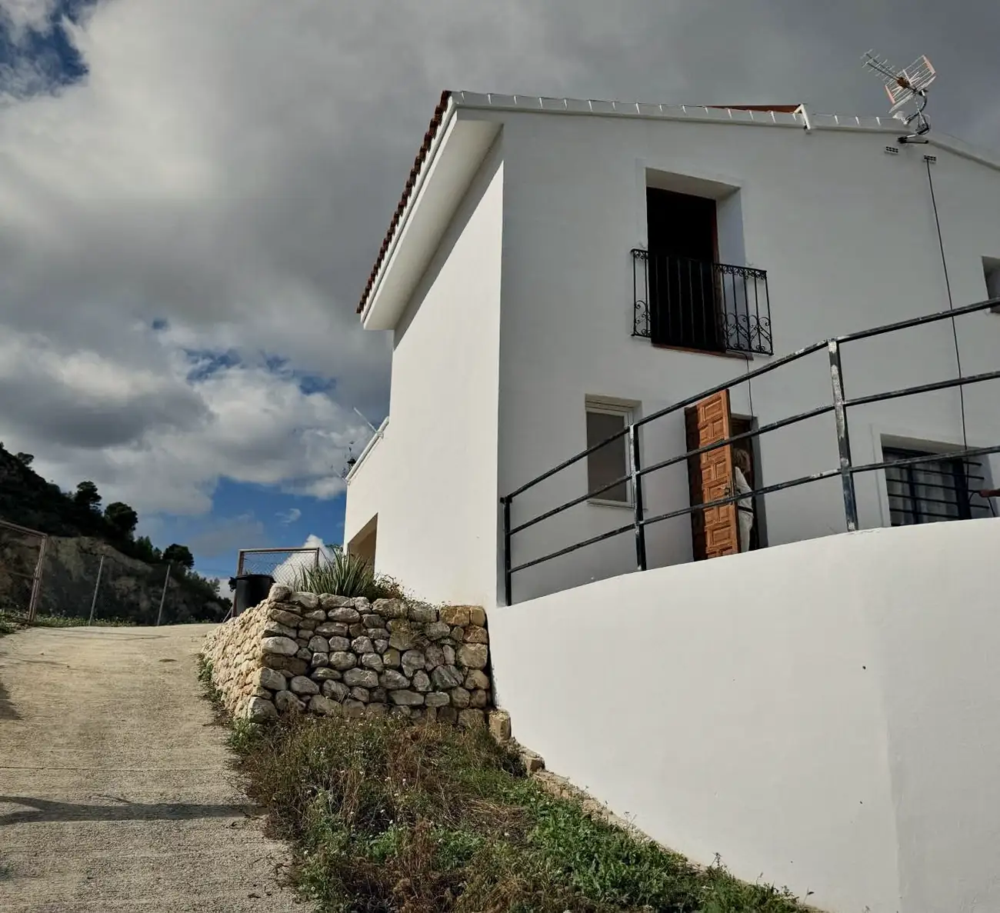

Ga ik dit weer voorbij laten schieten?

Maar ik voelde geen directe ja. Het rook wat vochtig. Het stond middenin andere gewassen. Een hoop pluspunten, maar ook weer vrij prijzig en een hoop werk.

En dan het geluid. De internationale weg ernaast, en tijdens de bezichtiging landbouwmachines.

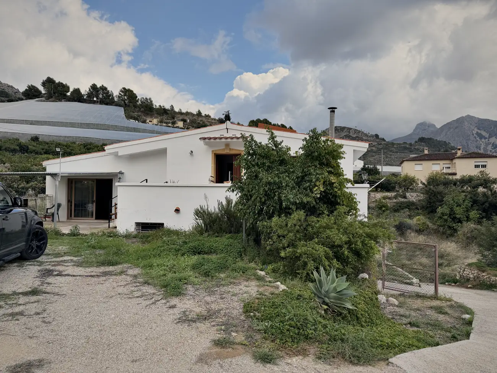

Mucho trabajo y muy caro.

Ik nam het wel serieus in overweging. Zaterdag 7 november heb ik er zelfs nog een tweede afspraak voor gemaakt. Dit huis bleef hangen.

Maar ook die keer weer: dat geluid. Ik weet het niet.

Straks ben ik weer te laat. Wat moet ik doen?

## Een nee in Orxeta

6 november. Vamos, we gaan naar Villajoyosa.

Heerlijk gewandeld, lekker op het strand gelegen, fantastisch weer. En ik was in gezelschap van mijn inmiddels vlam, zo kan ik het wel noemen.

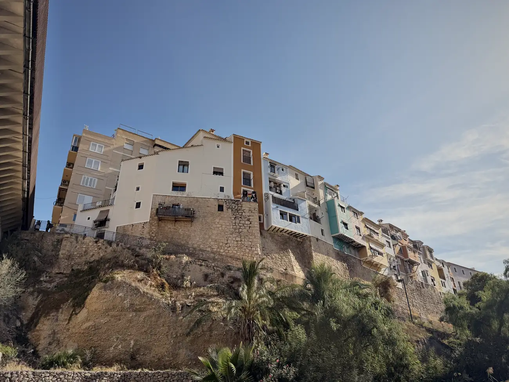

Daarna stond er een bezichtiging op de planning in Orxeta.

Oud, duur, wel groot. Maar ik voelde meteen een nee. Dit is het niet.

Ik heb niet eens foto's gemaakt van dat huis.

Niet wetende dat ik daar binnen een week weer zou staan.

## Kermis

Die zaterdagavond even naar Benidorm, naar de kermis. Het was feest die week.

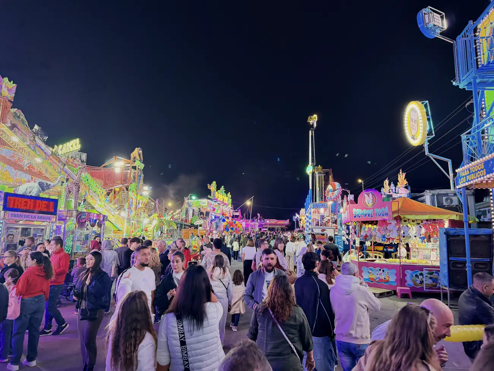

Ik hou van vuurwerk, maar hier gaan ze pas echt los.

Gelukkig is het nu afgelopen.

## Idealista uitgespeeld

Kort daarna kwam ik in contact met andere makelaars. Ik had Idealista na zo'n 2 jaar zoeken wel uitgespeeld.

En waar ik achter kwam: veel van mijn opgeslagen advertenties waren al snel 2 uur rijden vanaf Alfaz, waar ik nu zit. Daar kom je pas achter als je er bent.

Het is toch wel fijn om wat winkels in de buurt te hebben, al was mijn droom ergens middenin de bergen.

Dus dat ben ik gaan aanpassen. En dan blijkt dat het aanbod ineens een stuk kleiner wordt.

Alles is hier ook gewoon duur geworden. De prijsstijgingen in deze omgeving zijn extreem vergeleken met Nederland.

Ben ik net te laat?

## Dinsdag in Altea

Ik kreeg opnieuw 2 advertenties doorgestuurd.

Dinsdag gaan kijken bij een huis in Altea. Dit begint ergens op te lijken. Maar wel weer een hoop geld. De tuin stond vol fruitbomen en er was serieus wat moois van te maken, maar opnieuw heel veel werk.

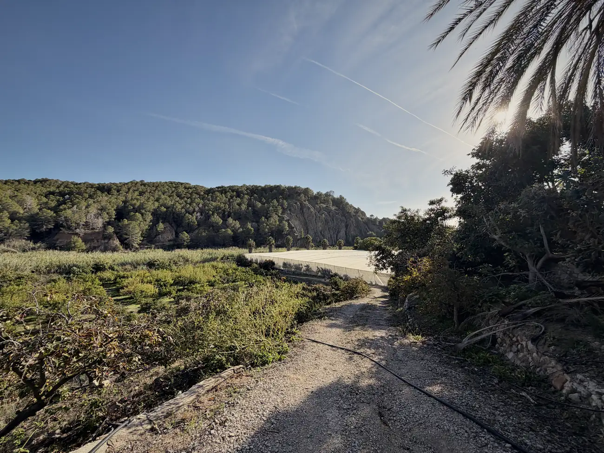

Ik slaap er een nachtje over.

En ondertussen zat ik naar die andere advertentie te kijken. Prijs heel interessant. Locatie top.

Ik wil daar kijken.

## Ik heb geen hypotheek nodig

En dan de makelaar.

Ja, helaas, er zijn al 2 geïnteresseerden in dit object. Morgen gaan ze naar de bank om te kijken voor een hypotheek. Ze waren al langer geïnteresseerd, maar doordat het feest was in Benidorm was alles dicht.

Daar sta je dan. Weer net te laat. En toen voelde ik iets wat ik in weken niet zo duidelijk had gevoeld: ik moet hier naartoe.

Luister. Ik heb geen hypotheek nodig. Kan ik morgen komen kijken in Orxeta? En als ik het wil kopen, dan bied ik 5.000 meer dan de huidige kopers.

Stilte.

Dat klinkt als een bijzonder aanbod. Ik ga het even overleggen met de verkoper.

Morgen, 09:30.

Oké. Tot morgen.

## 11 november

Hop, de auto in. Eerst snel mijn vlam oppikken in Benidorm en toen rechtstreeks naar Orxeta.

Gaat dit hem worden?

Ik had niet veel tijd en niet veel ruimte om na te denken, en ik moest stappen maken. Maar jeetje, wat is dit veel in korte tijd. En wat is dit spannend. Het gaat om serieus geld.

Eenmaal bij het perceel aangekomen stonden de eigenaar en de makelaar ons al op te wachten.

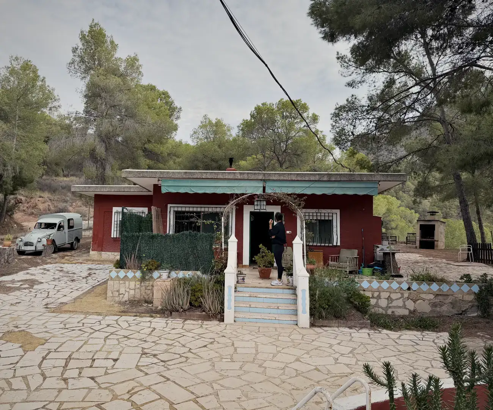

Het is echt middenin de natuur. En toch op rijafstand van alle voorzieningen in Finestrat, Sella en Relleu. In 30 minuten sta ik op het strand van Benidorm.

En dan het uitzicht.

Er is een plek op het terrein waar 2 stoeltjes staan, met zicht op de berg. Als je daar staat, lijkt de wereld stil te staan.

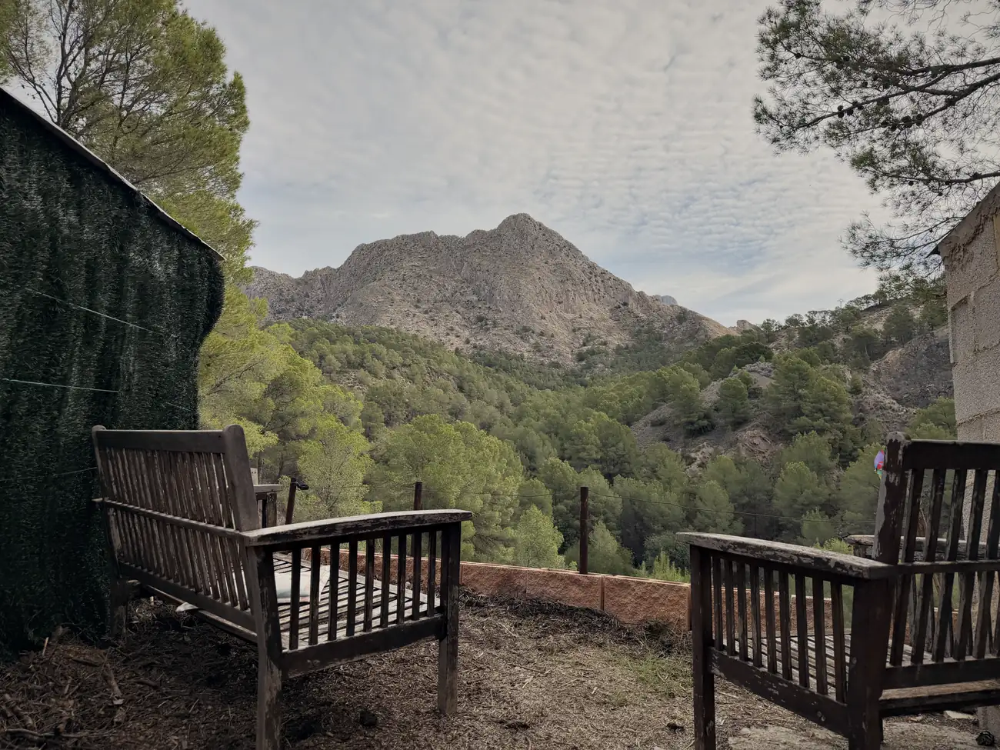

Dit is niet normaal. Hier moet ik zijn.

De verkoper was harder aan het werk dan de makelaar. Die man vertelde met zoveel passie over de omgeving en over het terrein dat je ervan smelt. Op leeftijd inmiddels, en het was hem te veel werk geworden om alles te onderhouden.

En juist daar ging ik op aan.

Een schattig huisje, maar een hoop werk. Het dak moet gedaan worden. Vocht in de muur. Alles is simpel.

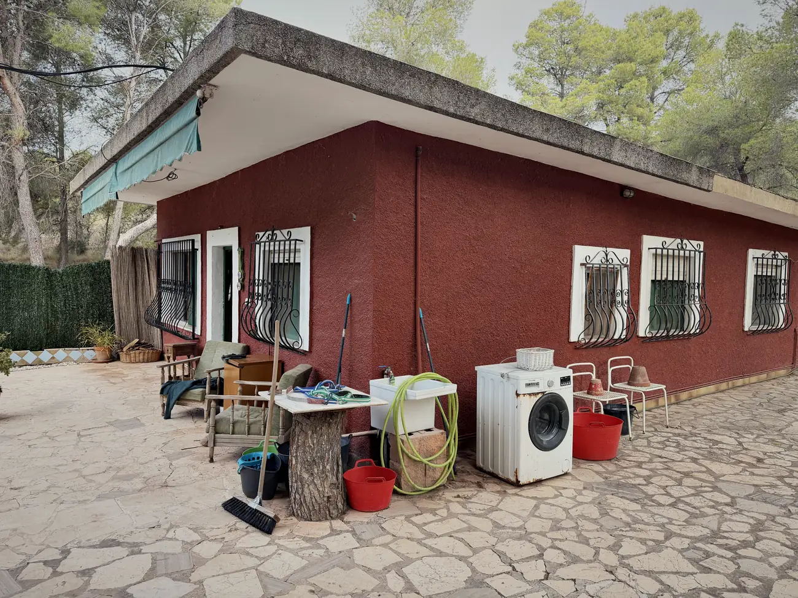

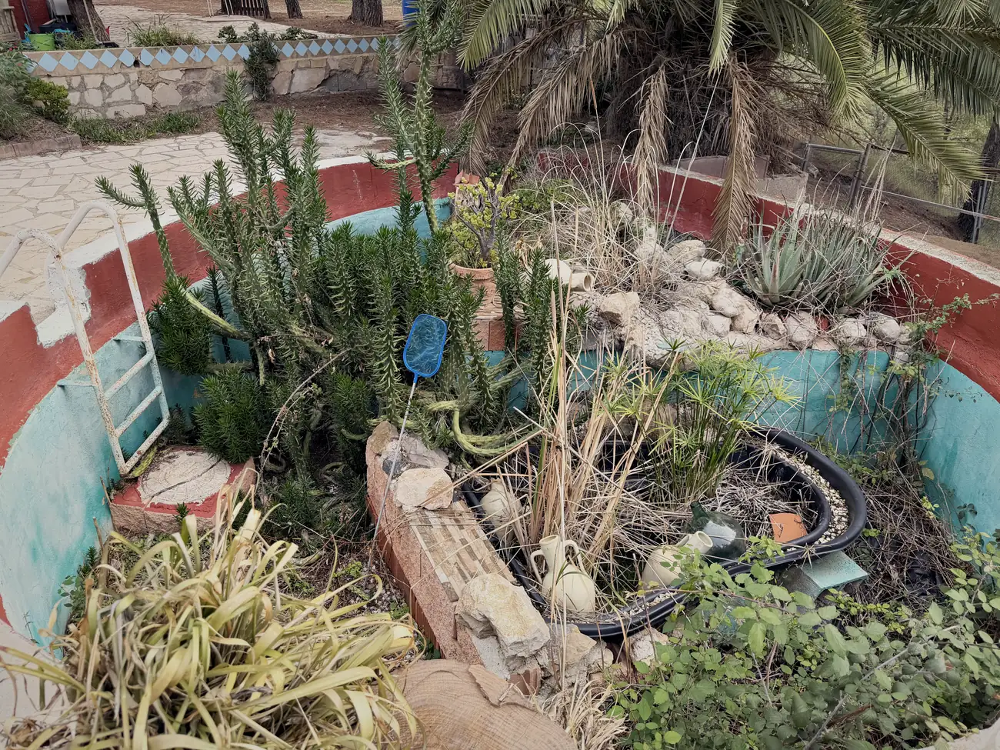

Maar daar was de prijs ook naar. En dat is precies het goede nieuws: als ik dit koop, houd ik genoeg budget over om alles op mijn gemak naar mijn zin te maken.

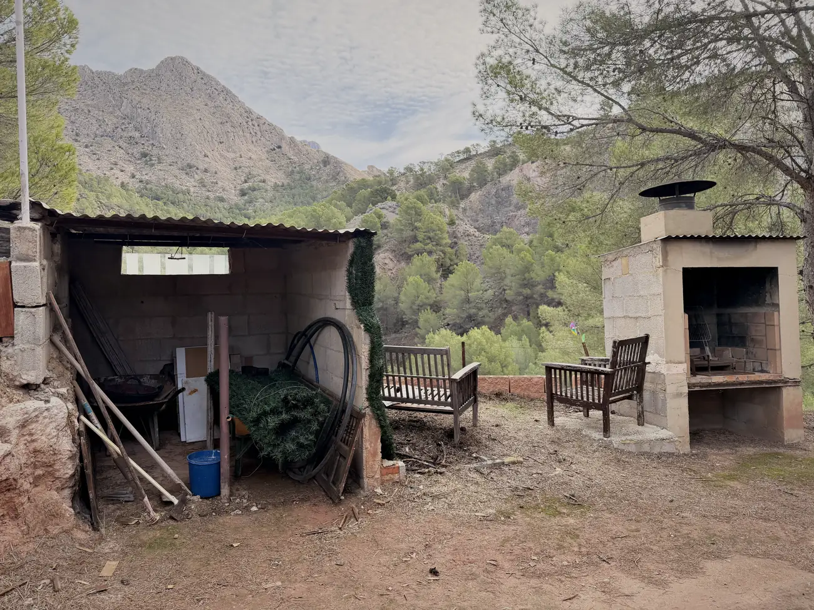

Bijna 10.000 m² grond. Middenin de natuur.

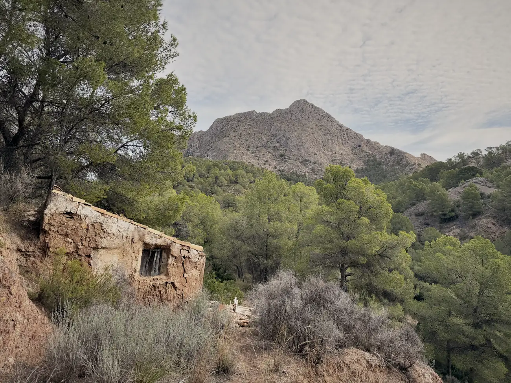

Het perfecte plaatje.

Ik heb ter plekke een bod gedaan. En dat werd geaccepteerd.

Direct 10% aanbetaald en de nodige papieren getekend, zodat ik niet weer buiten de boot val.

En weet je wat het gekke is? Hoe spannend ik al die dagen ervoor vond, zo ontspannen zit ik er nu bij.

Dit is het.

11-11. Om 11:11.

## De ezels van die man

Er wonen op dit moment nog 4 ezels op het terrein.

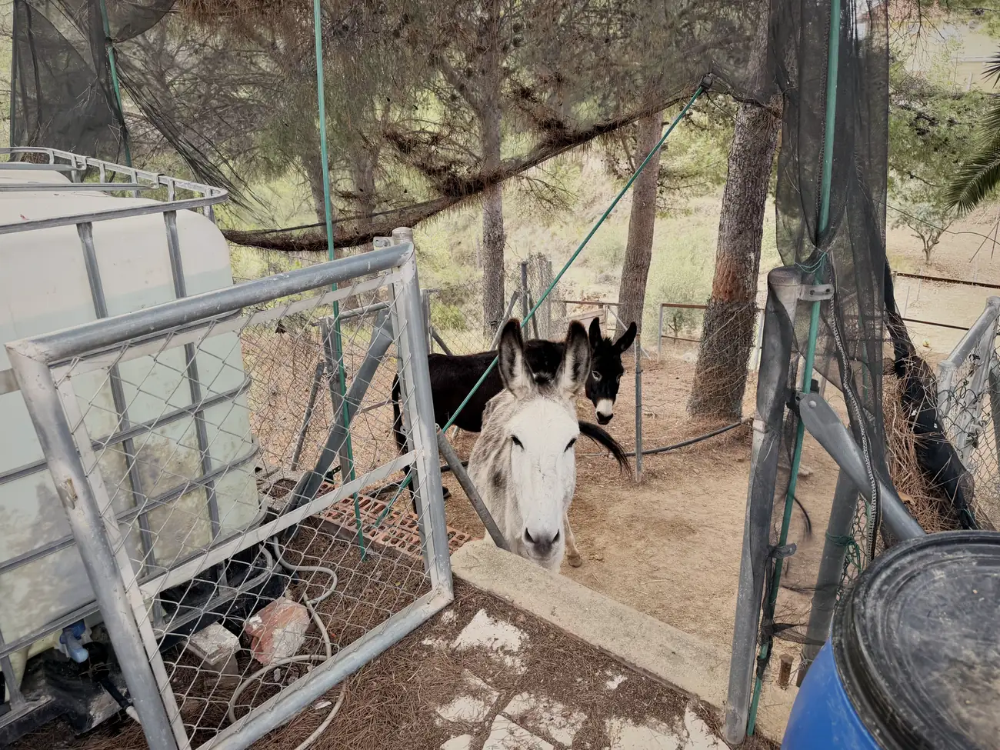

Die beste man is bezig met vervoer en vergunningen om ze mee te nemen. Want dit was zijn leven.

Ik ga hier geen ezels houden. Het worden kippen, en misschien een geit.

Maar wat een mooie, liefdevolle man. En wat heeft dit stuk een potentie.

## Waar ik terecht ben gekomen

Ik ben daarna gaan uitzoeken waar ik eigenlijk beland ben, en dat viel me niet tegen.

Orxeta is piepklein. 906 inwoners, verdeeld over 24 km², op 177 m hoogte. De meeste mensen die er wonen zijn er geboren en getogen. In het Valenciaans spreek je het uit als or-CHE-ta, in het Spaans heet het Orcheta.

Het ligt precies tussen de dorpen waar ik al die weken rondreed. In het westen grenst het aan Relleu, in het noorden aan Sella, in het oosten aan Finestrat. En in het zuiden aan Villajoyosa.

Alle vier kwamen ze langs in mijn zoektocht. En ik kom uit in het dorp dat er middenin ligt.

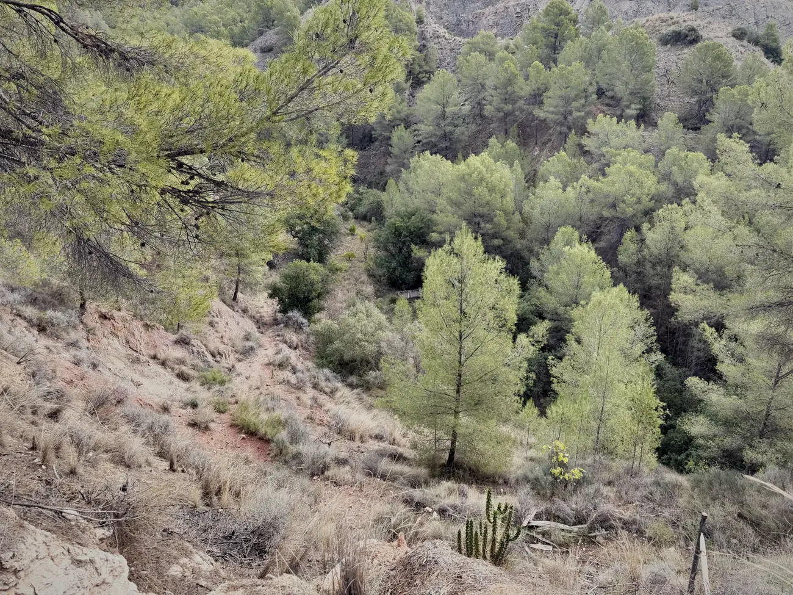

De rivier de Amadorio ontspringt in de Sierra Aitana, snijdt bij Orxeta door een kronkelende kloof en mondt uit bij Villajoyosa. Daarom heet hij daar ook wel de rivier van La Vila. Even verderop ligt het stuwmeer, dat turkooise water met die wandelpaden eromheen. Dat is straks mijn ommetje met Mo.

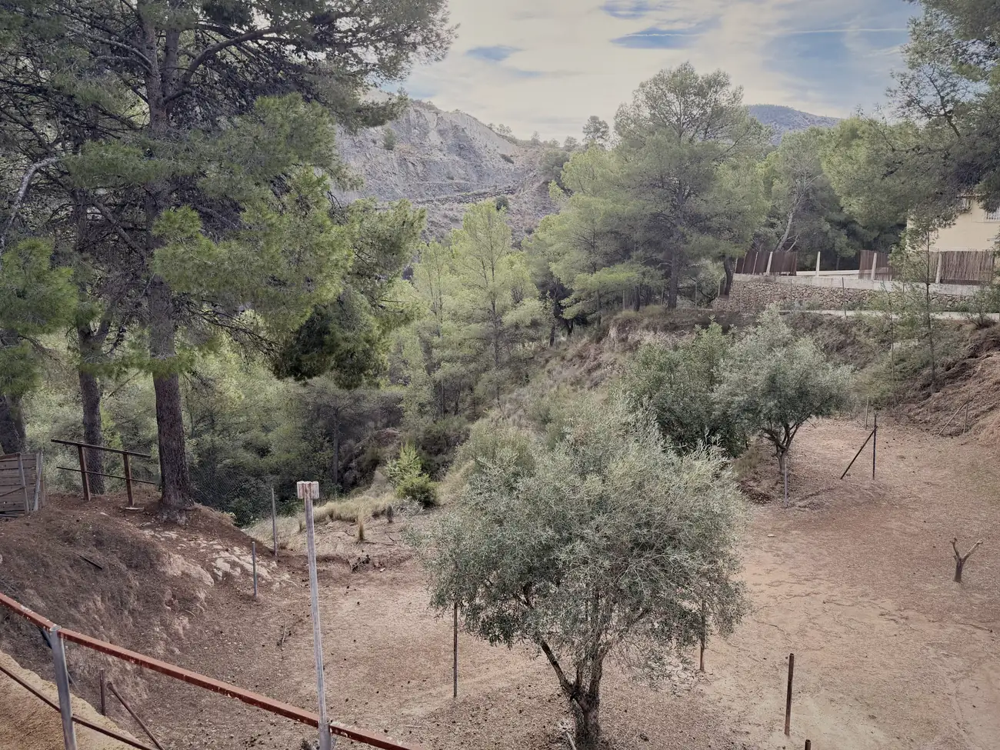

Boven het dorp liggen de resten van een Moors kasteel die over de vallei uitkijken.

En toen vond ik dit. Tot 1707 hoorde Orxeta bestuurlijk bij Xàtiva. Daarna, tot 1833, bij Alcoy.

1707 is precies het jaar dat Felipe V Xàtiva liet platbranden. Daar heb ik 2 weken geleden nog een heel hoofdstuk over geschreven, over dat portret dat daar nog altijd ondersteboven hangt.

Dat dorp waar ik nu een huis heb gekocht, hield in datzelfde jaar op bij Xàtiva te horen.

Allemaal gekke lijntjes weer.

## Alles stroomt

Ik ben helemaal aan.

Voor nu heb ik nog het nodige regelwerk te doen, maar ik zit er zo lekker in. En ik ben zo dankbaar voor het proces waar ik nu in zit.

Alles klopt. Alles stroomt.

Ik heb enorm veel zin in dit avontuur, en als het zover is maak ik er een mooie video van zodat jullie mee kunnen genieten.

Want wat kan de wereld veranderen in een paar weken tijd.

Ik hoop dat jullie kunnen meegenieten aan de hand van de foto's. Laat me weten wat je ervan vindt.

En er komt snel een video. 3 à 4 weken, gok ik.

Voor de kerst zit ik daar.
